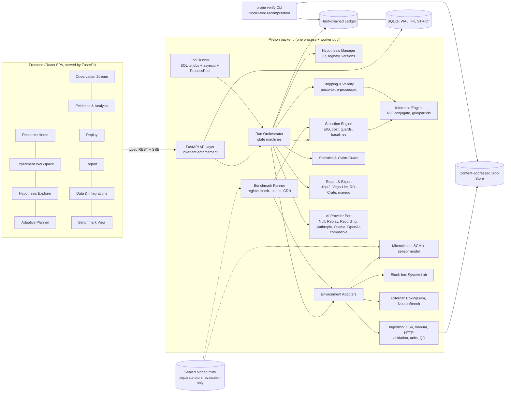

# PROBE — Session Handover

> **Purpose:** let any Claude session pick up the PROBE founding-CTO planning assignment if the current session ends midway.
> **Branch:** `claude/pensive-ptolemy-huq2mx` · **Originating session:** https://claude.ai/code/session_01WyyihpQzFz2ZYAdX8EKpJj
> **Last updated:** 2026-10-09. See the update log at the bottom.

---

## 0. TL;DR for the next session

- **Phase: PLANNING ONLY.** A strict approval gate is in force (§1). Do **not** implement anything.
- **Only exception:** this `handover.md` file. The user explicitly asked for it so work survives session loss. No other repository file may be created or modified before the user approves the final plan.
- **Progress:** Stage 1 is **done**. Stage 2 research is **mostly done**; condensed conclusions are in §7, and some verification is still running. Stage 3 (strategies, judging and plan sections) is **in progress**. If the originating session is gone, start from §7 and §8; re-running §9 is needed only to refresh the evidence.
- **Next:** the full plan (§12) has been presented for approval. **Wait for the user's decision.** The recommended initial approval scope is M0–M4: foundations through the benchmark go/no-go gate.
- The original user brief is the authoritative source. §2 is a faithful condensation of it. If the user can paste the original, prefer it.

---

## 1. Hard rules (approval gate; these override everything else)

The current phase is **planning only**. Permitted: read-only repository inspection, external research (web search/fetch, reading docs, papers and source repos), and temporary in-memory analysis or calculations.

**Forbidden before explicit user approval of the final plan:**
- Creating application source files, editing source files, or creating implementation documentation in the repo. `handover.md` is the sole user-authorized exception.
- Installing or upgrading dependencies. Creating databases or persistent app state. Running migrations. Changing project configuration.
- Modifying tracked or untracked project files, other than `handover.md`.
- Starting implementation, or launching subagents that modify files.
- Committing changes, other than `handover.md` updates. Deploying.
- Provisioning paid cloud resources, purchasing subscriptions, or consuming paid credits on external services.
- Starting implementation because a promising existing project was found.
- Creating plan or scratch files or task trackers **in the repo**. Present the plan in the response or through Plan Mode's plan file, which lives outside the repo.

Also:
- If formal Plan Mode is available, use it for the assignment. It was exited only to commit this handover, with user approval. Re-enter it (`EnterPlanMode`) to present the final plan, then `ExitPlanMode` to request approval.
- Do not claim tests, benchmarks or experiments were run when they were not.
- Never fabricate research findings, citations, costs, project files, capabilities or benchmark results.
- If a research source or tool is unavailable, report it and make a clearly labelled provisional recommendation.
- No PR unless the user explicitly asks. Push only to `claude/pensive-ptolemy-huq2mx`.

---

## 2. The mission brief (faithful condensation)

The user plays founder. Claude acts as founding CTO, principal AI research engineer, scientific-method specialist, staff architect, product strategist and implementation lead for **PROBE**.

### 2.1 Ambition (brief §1)
- **Not** another chatbot, personal assistant, multi-agent framework, RAG app, AI research summarizer, agent dashboard, synthetic-data generator, or generic "automated scientist" that writes convincing reports. These may be components; they are not the product.
- **Core question:** can an AI system autonomously turn a question about the world into a well-designed experiment, obtain real or simulated evidence, distinguish between competing explanations, decide which observation to collect next, and produce a reproducible conclusion whose validity can be independently checked?
- It must **perform** the experimental workflow, not just recommend steps.
- It must distinguish what it **suspects**, **predicts**, **observed**, and what its evidence **supports**.
- **Outputs:** executable protocols, structured hypotheses, recorded observations, independently verifiable calculations, uncertainty estimates, experiment histories, reproducible research artifacts. It investigates questions rather than retrieving information.
- **Long-term vision:** a general-purpose experimental discovery engine and platform where humans and AI formulate questions, run experiments, share validated protocols, contribute observations and build on reproducible findings. Users could be scientists (environment), engineers (how an unfamiliar software system behaves), companies (product hypotheses), or AI systems (resolving uncertainty about an unfamiliar API/environment).
- **Do not** pretend v1 achieves universal scientific intelligence. Build a narrow, technically credible foundation that extends toward the vision.
- **Goal:** find out whether there is a meaningful capability we can build *better than existing alternatives*, demonstrate it with real evidence, and possibly turn it into a business. An impressive demo is not enough.

### 2.2 Central research questions (brief §2)
- **Hypothesis A (adaptive experimental efficiency):** can adaptive, evidence-driven experiment selection produce more reliable conclusions per unit of experimental cost than fixed or random sampling, while staying reproducible and representing uncertainty properly?
- **Hypothesis B (learning to investigate unfamiliar environments):** can a system learn to select useful experiments in an unfamiliar environment by reasoning about competing explanations and possible observations, rather than following a fixed plan?
- These are hypotheses, not results. Be willing to find the methods do not beat baselines. Define what would count as convincing evidence for or against each.
- "AI-driven scientific experimentation" in general is **not** a sufficient novelty claim. Find a more specific, experimentally testable, differentiated contribution. If existing work already covers the direction, recommend a sharper hypothesis or a stronger product direction. Do not defend the original idea just because it came first.

### 2.3 Outcome over implementation method (brief §3, non-negotiable)
- No need to build everything from scratch. Find and assemble the **best possible solution**. The method matters less than the quality of the outcome. Everything in the brief is a starting point, not a fixed decision.
- **3.1 Explore the full solution space:** mature OSS, research repos, scientific computing / statistics / DoE libraries, active learning and Bayesian optimization frameworks, AI-scientist and experiment-orchestration platforms, commercial APIs, models (API and local), agent frameworks, execution and workflow engines, sensor platforms, datasets, ingestion tools, scientific visualization, sandboxing and containerization, reproducibility tech, cloud and managed services, implementations of relevant papers, commercial products to integrate or extend, and entirely different approaches. Search beyond familiar tools.
- **3.2 For every major capability, evaluate build / buy / integrate / reuse / adapt** on: capability and quality, reliability and limitations, maturity and maintenance, compatibility, integration complexity, development time, operational complexity, performance and scalability, security and privacy, licensing and commercial-use rights, API availability, rate limits and service restrictions, initial and recurring cost, cost at scale, vendor dependence and portability, extensibility, reproducibility and inspectability, and impact on differentiation. Choose on evidence, not popularity.
- **3.3 Reuse aggressively but intelligently.** Use established components for commodity capabilities. Focus custom engineering on differentiation, closing capability gaps, defensibility, or results others can't reach. Don't hand-build basic infrastructure. Don't glue random APIs together and call it a breakthrough. Before recommending a component, check its real capabilities, source, limitations, license, maintenance, compatibility and commercial suitability. For services, check failure modes, pricing, rate limits, data handling and portability. Proprietary dependencies need a documented fallback or migration path.
- **3.4 Look for the strongest existing implementations** for adaptive experimental design, statistical inference, simulation, data validation, experiment orchestration, provenance, reproducible execution, AI orchestration, scientific workflow engines, report generation, security and sandboxing, and benchmarking. Read papers, docs, repos, benchmarks and commercial offerings, and inspect actual code where practical. Six routes: (1) use as-is; (2) integrate behind an abstraction; (3) adapt or extend; (4) combine several; (5) replace a small part with custom code; (6) build new because the alternatives are inadequate. Justify the route chosen. Unverified or inaccessible implementations do not count as validated.
- **3.5 Don't force novelty into every component.** A possible differentiator is the combination of experimental planning, adaptive information acquisition, evidence verification and reproducibility, but do not assume it is novel. Let prior art decide. Never inflate an integration into a "revolution". A novel algorithm is worthless if it doesn't beat alternatives or solve a real problem.
- **3.6 Commercial tech is allowed** if it materially improves the outcome. You may investigate pricing, limits, terms and free tiers, and compare with OSS and local options. **Never** purchase, consume paid credits, provision billable resources or commit the user financially without explicit authorization. Never assume keys, accounts, licenses, free tiers or credits exist. If the best option is paid, name the dependency, estimate its cost and give alternatives. The initial demo must be practical and affordable.
- **3.7 At least three materially different solution strategies**, compared on: achievable capabilities, technical risk, reliability, research differentiation, development complexity, performance, cost, operational complexity, time to a credible demo, product and startup potential, and long-term extensibility. They must differ in substance, not just library choice. If fewer than three are credible, explain why.
- **3.8 The planning package must include** (in the plan, **not** written to the repo):
  1. Technology and Implementation Landscape.
  2. Build-vs-Buy-vs-Integrate Decision Matrix.
  3. Three Competing Architecture Strategies.
  4. Reuse and Extension Plan (use directly / adapt / custom).
  5. Dependency and Commercial-Risk Register (licenses, vendor dependencies, access restrictions, recurring costs, maintenance risks, fallbacks).
  6. Differentiation Analysis (differentiating vs commodity vs what could make PROBE undifferentiated).
  7. Recommendation and Rejected Alternatives, plus the conditions that would change the recommendation.

### 2.4 Research before architecture (brief §4)
- **Investigate:** AI for scientific discovery; automated experiment design; self-driving labs; active learning; Bayesian experimental design; expected information gain; hypothesis generation and evaluation; agentic scientific workflows; sensor networks and participatory sensing; causal inference and intervention-based reasoning; AI-generated experimental protocols; autonomous data collection and QC; reproducible computational science; scientific workflow orchestration; AI that selects and executes its own next experiments; related commercial products, startups and OSS alternatives.
- **For each important precedent:** (1) what it actually does; (2) implemented vs proposed capabilities; (3) its central technical contribution; (4) evidence for its claims; (5) benchmarks and baselines; (6) remaining limitations; (7) what it doesn't address; (8) overlap with and difference from PROBE.
- Cover direct competitors and adjacent products that could expand into the space. Using LLMs, multiple agents, a new UI or a new brand does not make something innovative.
- Record source links, publication dates and research status, separating papers, preprints, product claims and proposals. Never fabricate or imply a source was reviewed if it wasn't.
- **Required outputs:**
  - A related-work matrix: title, authors/org, date, link, central contribution, evidence, limitations, relevance.
  - Proposed contents (in the plan, not the repo) for `RELATED_WORK.md`, `COMPETITIVE_LANDSCAPE.md`, `RESEARCH_HYPOTHESES.md` and `ARCHITECTURE_DECISIONS.md`.
  - An **explicit answer to:** *"What is the most defensible technical and commercial differentiation available to us, given what already exists?"* If the idea is weakly differentiated, recommend a sharper hypothesis before implementation.

### 2.5 Initial application: campus microclimate discovery (brief §5)
- **Question:** how do shade, surface type, location and time of day relate to measured pedestrian-level temperature and thermal conditions? Which additional measurements would best distinguish the plausible explanations?
- This is a **candidate**, not permanent. Its advantages: understandable measurements, competing hypotheses, confounders, real observations are possible, a synthetic environment with known ground truth, quantitative evaluation of adaptive sampling, intuitive visuals, and a path to a data service.
- **Must consider** whether a different initial domain gives a better demo of the core tech or stronger startup potential, and decide on evidence.
- **Example hypotheses (not conclusions):**
  - Shaded locations have lower measured surface temperatures than comparable exposed ones under specified conditions.
  - Surface material explains more variation than shade.
  - An apparent shade effect is confounded by time, weather, location or sensor calibration.
  - The available observations cannot distinguish the explanations.
- Distinguish descriptive, predictive and causal analysis. Never claim causation from association. Specify how confounders are identified, how limitations are communicated, and how unsupported causal claims are prevented.

### 2.6 Three data modes (brief §6)
- **Mode A, deterministic simulation:** a synthetic environment with documented ground-truth parameters. It should eventually support configurable relationships, measurement noise, confounders, missing observations and sensor-error mechanisms. Always label results as **simulated**. Evaluate reusing existing simulation frameworks.
- **Mode B, imported datasets:** CSV import with column mapping to variables, units, timestamps, conditions and sources. It should support schema validation, missing-value handling, duplicate detection, unit validation, source preservation, data-quality warnings and preview before import. Keep the original data separate from normalized and transformed data. Evaluate existing ingestion and validation libraries.
- **Mode C, new real-world observations:** manual measurement entry plus a documented integration interface for external sensors, e.g. generic HTTP ingestion. Further integrations must be justified. The core demo must not depend on hardware or paid services. Evaluate existing sensor platforms and public datasets.

### 2.7 The scientific engine (brief §7)
Recommend existing libraries where they beat custom code.
- **7.1 Structured, versioned experiment representation:** research question, competing hypotheses, variables and units, candidate conditions, experimental units and sampling plan, controls, assumptions and confounders, measurement procedure, data sources and collection method, hypothesis-specific predictions, statistical analysis plan, stopping criteria, safety classification and required permissions, protocol version and execution state, provenance, and final results and limitations. Explain representation, validation, storage, versioning and linking. Don't rely on unstructured LLM text.
- **7.2 Hypotheses:** precise statements, conditions of applicability, predicted observations, supporting and contradicting evidence, assumptions, confounders and inter-hypothesis relationships. Use explicit priors and posterior updates **only** when a real probabilistic model supports them. No decorative probabilities.
- **7.3 Adaptive design:** evaluate at least (1) random, (2) predetermined fixed, (3) stratified where appropriate, and (4) adaptive information-gain-based sampling. Check libraries and research implementations first, and evaluate Bayesian EIG as a candidate. The selector must account for competing hypotheses, current uncertainty, possible outcomes, EIG, cost, feasibility, safety and permissions, sampling constraints and stopping criteria. Define the maths, assumptions, compute needs and limitations. Explain when EIG is inappropriate or can't be estimated reliably, and give a justified fallback. Every recommendation must expose the proposed action, which hypotheses it targets, why it may be informative, its EIG or alternative score, cost and feasibility, the other candidates considered, and why it was chosen. Preserve the full sequence of recommendations.
- **7.4 Statistics:** descriptive stats, regression, condition comparisons, uncertainty intervals, Bayesian updating, diagnostics, confounder checks and data-quality analysis, using established libraries. Document the assumptions behind each procedure. Never choose a procedure because it is convenient or gives a nice result.
- **7.5 Provenance per observation:** observation ID, experiment ID, sampling-unit ID, timestamp and timezone, variable and unit, value, measurement condition, collection method, instrument or source ID, calibration info, quality flags, missingness status, origin (simulated / imported / manual / external), and transformation history. Keep raw data separate from processed data. Minimize private data.
- **7.6 Reproducibility package per finalized experiment:** versioned protocol, hypotheses, data and source references, data dictionary, provenance, model and software versions, configuration, seeds, analysis scripts or executable specs, results and uncertainty, figures and tables, execution logs, limitations and reproduction instructions. **A replay must never silently replace recorded results with new LLM interpretations.** Evaluate existing workflow, provenance and reproducibility tech first.

### 2.8 AI orchestration layer (brief §8)
- The LLM may turn NL questions into structured objectives, suggest hypotheses and confounders, draft protocols, explain options, suggest candidate observations, interpret **validated** analytical outputs, write evidence-grounded reports and identify gaps. It is **not** the authority for calculations.
- **Deterministic code owns** schema validation, maths, candidate ranking, data-quality checks, provenance and result computation.
- **Providers to investigate:** Anthropic API (when configured), local models via Ollama or similar, other APIs if materially better, orchestration frameworks, and a **deterministic development provider** for offline use. Verify current docs; don't assume model IDs, endpoints, structured-output formats or reasoning fields.
- **Claude Code access ≠ product API credentials.** The default demo must work **without any model API key**. The dev provider must be explicitly labelled and must not impersonate a frontier LLM.
- Validate model output before execution or persistence. **Never execute arbitrary generated code** just because a model returned it.
- Provenance must distinguish LLM, deterministic computation, human operator, external source and simulation. Evaluate existing orchestration products before building custom ones.

### 2.9 Product experience (brief §9)
- It should feel like a premium scientific instrument plus a sophisticated AI research product. Not a generic admin template with gradients, glowing borders or meaningless charts. Distinctive, polished, information-dense where appropriate, accessible.
- **Screens:**
  - Research Home: active experiments, unresolved questions, recent findings, observations, data-quality issues.
  - Experiment Workspace.
  - Hypothesis Explorer: competing hypotheses, expected observations, supporting and contradicting evidence.
  - Adaptive Experiment Planner: candidates, usefulness, feasibility, cost, uncertainty, ranking explanations.
  - Live Observation Stream.
  - Evidence and Analysis.
  - Experiment Replay.
  - Research Report.
  - Data and Integrations.
- For each screen, specify the underlying data and the interactions it needs. Evaluate UI, visualization and dashboard libraries.
- The default UI works without an API key. Simulated data is visibly marked. Plan loading, empty, error and recovery states. Polish does not equal completeness.

### 2.10 Required flagship demo (brief §10), all with real state and calculations
1. Open a seeded environmental question.
2. Inspect multiple hypotheses.
3. Generate or edit a structured protocol.
4. Validate the protocol.
5. Initialize the deterministic synthetic environment.
6. Collect initial observations.
7. Inspect data and uncertainty.
8. Rank candidate next measurements.
9. Select an action with the adaptive strategy.
10. Execute it in the simulator.
11. Update analysis from the new observation.
12. Repeat until the stopping condition.
13. Produce a report from computed results.
14. Export a reproducible package.
15. Rerun with the same seed.
16. Compare adaptive against the baseline strategies.

No prerecorded animations, hardcoded scores or fabricated logs. **Define acceptance criteria for every stage.**

### 2.11 Research benchmark (brief §11)
- Compare adaptive against valid non-adaptive baselines under equal budgets, across multiple synthetic environments with known ground truth.
- **Scenarios:** strong and weak relationships; multiple competing hypotheses; noise levels; missing observations; imbalanced sampling opportunities; confounders; misleading correlations; limited budgets; **and cases where adaptive should not win**.
- **Ground truth is hidden from the agent** and visible only to the evaluator. Documented seeds, repeated runs.
- **Metrics:** correct-hypothesis rate, calibration, log loss / Brier, parameter error, uncertainty reduction, cost, observations needed to reach criteria, inconclusive rate, sensitivity to noise and confounding, and runtime/compute. Evaluate correctness, calibration and efficiency **separately**. **Being confidently wrong must not look like success.**
- Numbers come from actual execution only. The report covers environments, assumptions, baselines, protocols, sample counts, results with intervals, failure cases and reproduction commands.
- Propose a realistic local benchmark size plus a route to larger runs. Don't presume adaptive wins. Investigate existing benchmark frameworks.

### 2.12 Technology (brief §12)
- **Candidate stack, not decided:** React+TS, Python+FastAPI, Pydantic, SQLite (with a Postgres path), scientific libraries, an established execution/workflow engine, a charting library, and model APIs where justified. Inspect alternatives, including reusing a scientific platform or extending a research implementation.
- **12.1 Subsystems:** frontend, API, scientific engine, hypothesis management, selection algorithms, simulated environment, ingestion and provenance, statistics, AI provider abstraction, job execution, persistence, benchmark runner, report generation. State the route for each and what custom code remains.
- **12.2 Background execution:** long jobs must not block the API. Job states: queued, running, completed, failed, cancelled. Needs progress, error records, controlled cancellation and recovery after interruption. **No Redis or distributed workers without evidence** they are needed.
- **12.3 Persistence:** experiments, hypotheses, protocol versions, observations, sources, execution events, results and benchmark runs, with real relations and constraints. Not one big JSON blob. Use migration libraries.
- **12.4 Typed, documented APIs:** experiment CRUD, protocol edit and validate, hypotheses, imports and observation ingestion, candidate-action generation, simulation execution, results and histories, jobs, reproducible exports, benchmark runs, AI-provider config. **The backend enforces scientific invariants regardless of the frontend.**
- **12.5 Developer experience:** explicit dependencies, env config, migrations, fixtures, tests, benchmark scripts, setup docs. **Windows 11 and Linux.** Runs locally with no mandatory cloud.

### 2.13 Security, safety, integrity (brief §13)
- **Security:**
  - Strict input validation; uploads and external responses are untrusted.
  - Time and resource limits; sandboxing for any supported generated code.
  - Restricted outbound network; API-key protection; explicit configuration for integrations.
  - Review of destructive or irreversible actions; consent for experiments involving people.
  - Careful handling of precise locations and sensitive records; a way to stop active experiments.
  - Simulations may run automatically within limits. People, danger, sensitive data or physical actuators require permissions, safeguards and human oversight.
  - Never run dangerous experiments, manipulate people without consent, access private systems or over-collect personal data.
- **Integrity:**
  - Preserve raw data; document transformations and exclusions.
  - Distinguish missing values from zero; flag insufficient sample sizes; track provenance.
  - Separate exploratory from confirmatory analysis; document post-collection protocol changes.
  - Distinguish correlation from causation; report contradictory and inconclusive findings; make results reproducible.
  - Never produce authoritative reports from unverified model-generated "observations".
- **The plan must include a threat model with mitigations.**

### 2.14 Future extensions to evaluate, not necessarily build (brief §14)
- A: advanced adaptive design.
- B: multi-source evidence integration with conflict resolution.
- C: autonomous replication within tolerances.
- D: a generalized second environment, e.g. a black-box API discovered through controlled queries.
- E: AI-assisted collaboration (critics and proposers). **Agreement between LLMs ≠ independent verification.**
- F: an experiment knowledge exchange (templates, protocols, benchmarks).
- G: a general scientific API.
- H: an experimental OS where new domains plug in through interfaces.
- I: alternative product directions that keep the core ambition, compared with PROBE.
- Prioritize by evidence and value, not feature count.

### 2.15 Resources and cost (brief §15)
- Assess what runs locally, what needs external services, what might need rented GPUs, recurring costs, the most valuable paid dependencies, free and self-hosted alternatives, and what gets expensive at scale.
- The local simulation, engine, benchmark and default demo work **without credentials**. Optional providers are configured separately.
- No purchases or cloud commitments without explicit authorization. If expensive resources are needed, justify them and propose a cheaper validation route first.

### 2.16 Required workflow stages (brief §16)
1. Read-only reconnaissance.
2. Research and competitive investigation.
3. ≥3 strategies plus the build/buy/integrate matrix.
4. Refined hypothesis, domain, demo and measurable success criteria; document uncertainties.
5. The comprehensive execution plan.
6. **STOP for approval.**

---

## 3. Final deliverable: required content of the plan (brief §17)

| Part | Content |
|---|---|
| A | **Executive summary:** what PROBE will be; initial capability; what makes it ambitious; the research contribution investigated; what the first deliverable does and won't do; startup potential; what could cause failure. Separate established, proposed and speculative. |
| B | **Research and competitive assessment:** related-work matrix, leading competitors, overlaps, limitations, strongest differentiation, source links, verified vs assumed. Recommend hypothesis changes if needed. |
| C | **Technology landscape:** best tools, libraries, research implementations, APIs, commercial products, models and infrastructure; what they provide; remaining gaps. |
| D | **Build/buy/integrate matrix** for every major subsystem: alternatives, recommended route, effects on quality, reliability, cost, complexity, research value and commercial viability; reuse directly / adapt / build from scratch. |
| E | **Three competing architecture strategies** compared on common criteria, with a recommendation (or an explanation if fewer than three are credible). |
| F | **Recommended architecture:** Mermaid diagram covering frontend, API, scientific engine, hypothesis manager, selection algorithms, simulator, ingestion and provenance, statistics, AI adapters, execution engine, DB, benchmark runner and report generator, with each component's purpose and ownership. |
| G | **Data model and API contracts:** entities, relations, key fields, validation rules, state transitions, and the boundaries between deterministic computation, AI-assisted reasoning and experiment execution. |
| H | **Scientific-method design:** the environment, hypotheses, variables, candidate actions, sampling methods, stopping criteria, data quality, statistics and uncertainty; **the maths of adaptive selection** (assumptions, equations, compute, limitations); prevention of data leakage and misleading conclusions. |
| I | **Benchmark and evaluation plan:** baselines, conditions, seeds, repetitions, metrics, budgets, success criteria, reproduction instructions, and which results support or falsify the hypotheses. |
| J | **Implementation roadmap:** ordered milestones, each with objective, deliverables, files and components affected, dependencies, required tests, acceptance criteria, main risks and definition of done. Ordered by dependency and risk reduction, not visual appeal. Identify the **earliest complete end-to-end vertical slice**. |
| K | **Repository and file-change plan:** based on the actual repo (existing vs new files), proposed tests and integration verification. |
| L | **UI and product design:** screens, navigation, interactions, design system, data dependencies, error states, responsiveness, and how the UI shows a *functioning* experiment. |
| M | **Security and reliability:** threat model, execution boundaries, data-integrity risks, scientific failure modes, safeguards, and license, vendor and privacy considerations. |
| N | **Resource and cost assessment.** |
| O | **Risk register, top 10:** each with probability, impact, early warning signs, mitigation and fallback. Covers technical, research, competitive and startup risk. |
| P | **Acceptance criteria:** scientific correctness, reproducibility, benchmark validity, app functionality, UX, security, reliability, cost, setup and installation. Runnable, testable, independently inspectable. |
| Q | **Approval decisions:** the small set of high-impact decisions that need user judgment, each with a recommended option and alternatives. No routine engineering questions. |

Also include the seven §2.3/3.8 items and the proposed contents of `RELATED_WORK.md`, `COMPETITIVE_LANDSCAPE.md`, `RESEARCH_HYPOTHESES.md` and `ARCHITECTURE_DECISIONS.md`, **inside the plan, not as repo files**.

**Operating principles (brief §19):**
1. Investigate before recommending.
2. Explore alternatives before committing.
3. Optimize for outcome, not custom code.
4. Prefer proven components where they are better.
5. Build custom only where it creates an advantage.
6. Make claims traceable to evidence.
7. Separate novelty, engineering value and business value.
8. State assumptions and uncertainty.
9. Decide where reasonable rather than asking unnecessary questions.
10. Preserve useful existing work.
11. A design doc is not an implemented capability.
12. Simulated is not real.
13. Don't prioritize polish over the scientific engine.
14. Don't assume the original direction is best.
15. Don't continue into implementation after presenting the plan.

If implementation is later approved, specialist subagents (prior-art, statistics, architecture, backend, frontend, testing, security) may be used with clear scopes and no conflicting concurrent edits. The CTO remains responsible for integration and verification.

**Definition of a successful plan (brief §20).** The user can determine:
- whether the problem is worth solving, and whether the direction is differentiated;
- what to reuse and what to build;
- the architecture, how the scientific method works, and how the adaptive algorithm is tested;
- how the demo works and how the benchmark validates or falsifies the hypothesis;
- the resources needed, the failure risks and the startup opportunity;
- what "done" means and what they approve by authorizing implementation.

The plan must be concrete enough to start without rediscovering basic decisions, while staying flexible where research hasn't settled them.

---

## 4. Status by stage

| Stage | Status | Notes |
|---|---|---|
| 1. Read-only reconnaissance | ✅ Done | See §5. Repo is effectively empty. |
| 2. Research and competitive investigation | ✅ Done (with limits) | 11/11 dimensions researched; 5 adversarially verified. The other 6 were cross-checked by the CTO plus targeted searches. MDA [S], BED-LLM (ICLR 2026) [S], POPPER (ICML 2025) [S] and Sloman 2022 [S] are confirmed. Repeated usage limits stopped the rest of the verification. |
| 3. ≥3 strategies + build/buy/integrate matrix | ✅ Done | S1–S3 drafted by advocate agents; S4 and the judging done by the CTO (judge agents hit the usage limit). Recommendation: S1 base + grafts. |
| 4. Refine hypothesis, domain, demo, success criteria | ✅ Done | A′/A″/B′ in §12 Part H.10 |
| 5. Comprehensive plan (Parts A–Q) | ✅ Done | Full text in §12 |
| 6. Stop for approval | 🔄 Awaiting user | Presented via Plan Mode on 2026-10-09. **Do not implement until the user explicitly approves.** |

---

## 5. Verified environment and repository facts (2026-10-09)

- **Repo:** `parthvarekar/probe`. Branches: `main` and `claude/pensive-ptolemy-huq2mx`, both at commit `4fd56f5` ("Initial commit", Parth Varekar) before this handover. The only file is `README.md`, containing `# Probe` with no trailing newline. **No existing code, conventions or dependencies to preserve.** The architecture is unconstrained.
- **Cloud container used for planning:** Python 3.13.16, Node v22.22.0, npm 10.9.4, pnpm, uv 0.11.32, Docker CLI present, git. 4 vCPU, 15 GiB RAM, **no GPU**. Outbound HTTPS goes through an agent proxy. These are facts about the *planning* environment, not the user's machine. The target is a local Windows 11 and Linux developer machine.
- **GitHub tooling scope:** `mcp__github__*` tools are scoped to `parthvarekar/probe` only. Read other public repos through ordinary web fetches of github.com pages, not the GitHub MCP tools.

---

## 6. Verified facts gathered so far

### 6.1 Anthropic API (source: the bundled `claude-api` reference skill, model table cached 2026-10-06; re-verify before final cost numbers)

| Model | ID | Context | $ / 1M input | $ / 1M output |
|---|---|---|---|---|
| Claude Fable 5.1 | `claude-fable-5-1` | 1M | 10.00 | 50.00 |
| Claude Opus 5.5 (current Opus) | `claude-opus-5-5` | 1M | 4.00 | 20.00 |
| Claude Sonnet 5.5 (current Sonnet) | `claude-sonnet-5-5` | 1M | 2.00 | 10.00 |
| Claude Haiku 5.5 (current Haiku) | `claude-haiku-5-5` | 1M | 0.10 (≤100K-token prompts; 0.50 beyond) | 0.50 (2.50 beyond) |

- **Structured outputs:** `output_config: {format: {...}}` (JSON schema), with `client.messages.parse()` for validated parsing. **Strict tool use:** `strict: true` on the tool definition, which requires `additionalProperties: false`.
- **Forced `tool_choice` (`any`/`tool`) returns HTTP 400 on Opus 5.5, Sonnet 5.5 and Fable 5.1.** Use `auto` + `strict: true`, or structured outputs.
- Thinking cannot be disabled on Opus 5.5; control it with `output_config.effort` (default `medium`). No assistant prefill on current models. Handle `stop_reason: "refusal"`.
- **Message Batches API:** 50% cost, asynchronous. **Prompt caching:** prefix-based, up to 4 breakpoints; cache reads are cheap (e.g. $0.20/MTok on Opus 5.5 and Sonnet 5.5).
- **Implication for PROBE:** a high-quality optional provider exists, with schema-enforced outputs suitable for validated hypothesis and protocol drafting. **No API key is assumed for the product**, so the default demo must use a labelled deterministic dev provider.

---

## 7. Research results (interim, 2026-10-09)

### 7.0 Run status and constraints
- **Research workflow `wf_181ed593-9f9`:** all 11 research agents completed. Verifiers completed for 3 dimensions (ai-scientist-systems, hypothesis-validation-benchmarks, boed-theory). The other 8 verifiers and the completeness critic failed at a usage limit. They were resumed (task `wcj45svms`) with network guidance and an added "re-verify" step for the claims the first verifiers could not check. **Results pending.**
- **Design workflow `wf_80edc487-99b` (task `wpsry8m1m`), pending:**
  - 4 competing strategies: S1 deterministic evidence engine; S2 probabilistic-programming platform; S3 LLM-agent investigator; S4 verification and benchmark layer;
  - 3 judges (research rigour, startup, delivery risk);
  - 6 specialist plan sections (H; I; F/G/K; J/P; M/N/O; L);
  - a red team.
- **Network constraint (important for any new session):**
  - The environment's network policy blocks arxiv.org, nature.com, openreview.net, api.semanticscholar.org, api.crossref.org, biorxiv.org and many company sites for WebFetch and curl.
  - WebSearch works but draws on a shared budget, which was exhausted once.
  - github.com, raw.githubusercontent.com and pypi.org are reachable.
  - Consequence: **many paper-level numbers and venues are unverified.** Repo and PyPI facts (licences, releases, code behaviour) are mostly verified.
  - The user can allow-list these domains in the environment's network settings.
- Raw results live only in the originating container (`…/scratchpad/research/*.json` and the workflow `journal.jsonl`). A new session cannot see them, which is why the conclusions are condensed below.

### 7.1 Headline conclusions
Tags: **[V]** verified from a primary source (repo/PyPI/docs); **[S]** confirmed by search snippets only; **[U]** unverified.

1. **Hypotheses A and B as stated are not novel.** Choosing observations by expected information gain (EIG) among competing generative hypotheses is classical; the prior art includes:
   - Box & Hill 1967, and ADO (Cavagnaro/Myung/Pitt 2010) [U-bibliographic];
   - ADOpy [V: GPL-3.0; single-model only; does not discriminate between models];
   - BOSMOS, online model-selection design with misspecification experiments (Comput. Brain & Behavior 2023) [V via repo];
   - BoxingGym, Stanford [V: MIT; 10 PyMC environments; nested-Monte-Carlo EIG regret; last commit 2025-07-30; confirmed location-finding likelihood bug; the PyPI `boxing-gym` name is an unrelated package] [S: NeurIPS 2025];
   - Piriyakulkij et al., NeurIPS 2024 [V via repo];
   - BED-LLM, ICLR 2026 [U];
   - POPPER, sequential falsification with e-values [V code: p→e calibrator κ·p^(κ−1), product > 1/α; no LICENSE file in the repo, PyPI says MIT; stale since 2025-05];
   - Ai2 AutoDiscovery [V: Apache-2.0 `asta-autodiscovery` CLI on PyPI, 1.0.1 (2026-09-04); needs a cloud LLM];
   - Active Bayesian Causal Inference and CBED (NeurIPS 2022) [U];
   - Active Statistical Inference (Zrnic & Candès 2024) [U];
   - Krause et al. 2008 GP sensor placement [U].
2. **Most critical overlap: the Model Discovery Agent** (K. Murphy, arXiv 2608.09696, Aug 2026) [U; being re-verified]. Reportedly:
   - an LLM proposes mechanistic models;
   - SMC/SBI inference, with VOI/EIG choosing interventions;
   - the model class is reopened when predictions fail (M-open).

   A third-party critique says joint model-plus-parameter disagreement did *worse* than random on BoxingGym location finding. MIT `neuronbench` and `glucosebench` exist on murphyk's GitHub [V]. If the paper is confirmed, PROBE's methodological overlap is near-total.
3. **Close neighbours on verifiability and reproducibility:**
   - **simjecture** [V: Apache-2.0, first release Aug 2026]: LLM-led falsification with frozen inputs, receipts, hashes and model-free record verification; no EIG.
   - **ARA protocol** [V: MIT]: claims/evidence/trace with user/AI provenance tags.
   - **sciagent** [V: Apache-2.0, single author, v1.0 on 2026-10-01]: a deterministic, preregistered research-agent benchmark with BOED, random and oracle baselines. It reports an "evidence wall": BOED never chose the decisive observation because no hypothesis it entertained made that observation informative.
   - **IvoryOS** [V: MIT, v1.7.0, Windows-tested local SDL orchestrator with Ax/BayBE plug-ins and an optional LLM].
   - **Urban Cooling Agent** [V: MIT; React+FastAPI+LLM microclimate simulation; no hypotheses, adaptive design or provenance].
4. **Market:**
   - The "AI scientist" story is owned by heavily funded players: Lila (~$550M) [S/U], Periodic (~$300M seed) [U], Edison/Kosmos ($70M seed, ~$200 per run) [U], plus Google co-scientist and Sakana.
   - Adaptive allocation and Bayesian optimization are commodity: Ax, BoTorch, BayBE and Optuna [V]; GrowthBook ships bandits; Statsig→OpenAI and Eppo→Datadog [U].
   - SDL vendors target wet labs.
   - **White space (narrow):**
     - model *discrimination*, not optimization;
     - cheap observational, field or software settings;
     - a deterministic offline core that needs no key;
     - conclusions scored for calibration;
     - honest negative regimes;
     - bit-replayable decisions;
     - mechanical enforcement of claim strength.
   - Microclimate: a good demo with an unproven buyer.
   - Candidate wedges: education (teaching experimental design without hardware); a verification and audit layer for AI-generated empirical claims; later, vertical adaptive monitoring.
5. **Engine recommendation (strong consensus across dimensions):**
   - Use numpy/scipy only, with conjugate Normal-Inverse-Gamma linear hypotheses. These give exact evidence and Student-t predictives.
   - **Model-indicator EIG = H[mixture predictive] − Σ_m π_m H[t_m]**, computed by deterministic 1-D quadrature. Parameter EIG is closed-form.
   - Selection is cost-aware.
   - Pyro `nmc_eig` and brute-force Monte Carlo serve only as test oracles.
   - Optional extras: NumPyro / PyMC 6 SMC, dynesty (MIT), a scikit-learn GP residual hypothesis, pyABC.
   - Avoid BOED-specific dependencies because of churn [V]: Pyro had a 28-month release gap; pyDOE3 was archived 2026-05; NIST optbayesexpt was archived 2026-10-07; Trieste, HEBO and Summit are pinned to old stacks.
6. **Validity under adaptivity:**
   - Likelihood inference ignores the design only if the selection rule is logged exactly.
   - Naive means and fixed-n CIs are biased.
   - Use anytime-valid e-processes or confidence sequences, reimplemented. confseq has no Windows or Python 3.11+ wheels [V]. `expectation` is GPL plus an AI-training clause [V].
   - Use randomization with logged propensities for design-based claims.
   - Failure modes to plant in the benchmark: active-learning bias under misspecification (Sloman 2022) [U]; negative interference; the evidence wall; myopia; flat information landscapes; drift; a sun-dependent sensor bias confound.
7. **Claim-guard levels:** L0 simulated · L1 convenience observational (descriptive only) · L2 probability/stratified sampling · L2a adaptive observational (model-based only) · L3 DAG + identification + refuters + sensitivity (conditional causal) · L4 controlled non-randomized intervention · L5 randomized intervention.
   - Automatic downgrades: Moran's I, PPC failure, R-hat/ESS, Pareto k, uncorrected multiplicity, QC failure, protocol deviation.
   - A "no effect" claim needs equivalence/ROPE evidence.
   - The LLM may only paraphrase within the permitted level; a lexicon validator checks it.
8. **Infrastructure:**
   - Python 3.12/3.13 with uv.lock.
   - FastAPI (pin exactly; still 0.x) [V]. Pydantic v2 domain models kept separate from SQLAlchemy 2.1 + Alembic (batch mode).
   - SQLite with WAL, foreign keys, STRICT tables and CHECK constraints.
   - SQLite job table, an in-process worker, and a ProcessPool for benchmark sweeps. No Redis. DBOS (MIT; SQLite default since 3.x; not CI-tested on Windows) [V] or Huey kept behind an interface.
   - A hash-chained append-only ledger and a sha256 content-addressed blob store.
   - Export PROV-JSON (`prov` 3.2.2, MIT) [V] and a Workflow Run RO-Crate (ro-crate-py 0.16) [V].
   - Pandera, Table Schema and pint at ingest.
   - Jinja2 HTML reports, with optional typst PDF. A marimo notebook in each bundle for independent recomputation.
   - **Reproducibility contract:** decisions match exactly; floats match within tolerance, since BLAS differs between Windows and Linux.
   - **No execution of generated code in v1:** RestrictedPython had escape advisories in 2026, and Pydantic archived its Pyodide sandbox [V].
9. **LLM layer:**
   - PROBE defines its own provider port, with Null, Replay, Recording, Ollama, OpenAI-compatible and Anthropic implementations.
   - Not in the core: LiteLLM (PyPI compromise of 1.82.7/1.82.8 on 2026-03-24) [V], LangChain, DSPy, or agent SDKs.
   - LLM output enters only as `epistemic_status='proposed'`. Replay never re-calls a model.
   - Cost per full-assist session: about $0.015 (Haiku 5.5) to $0.58 (Opus 5.5).
10. **Frontend:**
    - Vite 8 + React 19 + TypeScript SPA, served by FastAPI `app.frontend()` from a built dist shipped in the wheel, so there is no Node at runtime.
    - shadcn/ui on Base UI, with Tailwind and React Aria.
    - Vega-Lite figures of record generated by the backend (Altair) and exported with vl-convert. uPlot for streams; visx/D3 for signature views.
    - React Flow + dagre; TanStack Table/Query/Router; FastAPI native SSE; Playwright + Vitest.
    - **Charts never compute statistics:** Vega's bootstrap CI uses `Math.random`.
11. **Domain:**
    - Keep microclimate as the narrative and UX flagship, using a custom structural causal simulator with an explicit sensor model (the radiation-shield error confound). SOLWEIG is GPL and treats air temperature as an input [V].
    - Stratified sampling is a very strong baseline in this domain.
    - Portable shade makes randomized interventions possible.
    - **Add a "black-box system lab"** as an evidence-bearing second environment: planted rate-limiter, cache and retry behaviours, with AALpy, random and stratified baselines.
    - External benchmark adapters: 2-3 BoxingGym environments (pin commit `b43e38c`; patch and report the bug) and NeuronBench.
    - Optional live-human adaptive-design demo (delay discounting).

### 7.2 Emerging positioning (to be stress-tested by the design workflow and red team)
PROBE is **not** "an AI scientist" and does **not** claim a new adaptive-design algorithm. The candidate position: **a deterministic, auditable engine that decides which observation to make next in order to tell competing explanations apart.** Its conclusions are calibrated, replayable and capped in strength by the study design. It publishes the regimes where adaptive selection helps, ties and loses. The LLM is optional and never authoritative.

The research contribution is to be refined into falsifiable form, for example: *a calibrated regime map of adaptive model-discrimination design under misspecification, cost and confounding, with mechanical claim-strength enforcement.*

### 7.3 Pre-research hunches (from §7.1 of the first version): outcome
- Overlap with BoxingGym, POPPER, BED-LLM, Piriyakulkij and AutoDiscovery: **confirmed**. Additional overlap found: BOSMOS, MDA, simjecture, sciagent, IvoryOS.
- "Misspecification-robust adaptive discrimination" as the sharper hypothesis: **still the leading candidate**, now with known prior art to cite (BOSMOS misspecification experiments, Sloman et al., generalised-Bayes BOED, arXiv 2511.07671 [V code]).
- Architecture direction (numpy/scipy core, FastAPI, SQLite, React, optional LLM): **corroborated** by all infrastructure dimensions.
- Black-box API environment: **recommended** by the alternative-domains dimension as the second environment.

---

## 8. Next steps (ordered)

1. ✅ **Research collected and condensed** into §7.
2. 🔄 **Finish verification:** task `wcj45svms` re-runs 8 verifiers, 3 re-verifiers for unverified load-bearing claims (MDA first), the completeness critic and up to 5 gap-fills. Fold any corrections into §7, especially MDA and any newly found direct competitor.
   - **New session, originating session gone:** re-verify the [U] items in §7.1 with WebSearch. Start with MDA (arXiv 2608.09696), BED-LLM, BoxingGym results, POPPER venue and results, Sloman et al. 2022, and Kosmos accuracy figures.
3. 🔄 **Design workflow** `wf_80edc487-99b`. The new-session equivalent runs these read-only:
   - (a) four strategies, then three judges with different lenses. The strategies are: S1 deterministic evidence engine, a lean numpy/scipy model-discrimination core plus an integrity layer; S2 probabilistic-programming platform (NumPyro/PyMC, BoTorch, IvoryOS/DBOS); S3 LLM-agent investigator with verified tools (MDA/Box's Loop style); S4 verification and benchmark layer, PROBE as a trust layer. The judge lenses are research rigour, startup, and delivery risk.
   - (b) specialist sections: H (maths and scientific method), I (benchmark), F/G/K (architecture, data/API, repo), J/P (roadmap and acceptance), M/N/O (security, cost, risks) and L (UI).
   - (c) a red team on differentiation, domain choice, the refined hypotheses, and the founder decisions (Part Q).
4. **Synthesize the final plan** covering Parts A–Q (§3), the seven §2.3/3.8 deliverables and the proposed contents of `RELATED_WORK.md`, `COMPETITIVE_LANDSCAPE.md`, `RESEARCH_HYPOTHESES.md` and `ARCHITECTURE_DECISIONS.md`. Reconcile with the verification results. Mark every unverified claim.
5. **Present it:** `EnterPlanMode` → write the plan to the plan file → `ExitPlanMode`. **STOP. Wait for explicit approval.** The user may approve, request revisions, approve only some milestones, or reject.
6. Update this file at each step: commit and push `handover.md` only.

---

## 9. Research workflow (re-runnable)

Run it with the **Workflow** tool by passing the script below as `script`. Its agents are instructed to be strictly read-only. Pattern: `pipeline(DIMENSIONS, research → adversarial verify+digest)`, then a completeness critic (barrier), then ≤5 gap-fill agents.

<details>
<summary>Full workflow script (as launched 2026-10-09)</summary>

```js
export const meta = {
  name: 'probe-landscape-research',
  description: 'Read-only research sweep for PROBE: 11 research dimensions, adversarial source verification, completeness critique and gap-filling',
  phases: [
    { title: 'Research', detail: 'one deep-research agent per landscape dimension' },
    { title: 'Verify', detail: 'adversarial fact-check + compact corrected digest per dimension' },
    { title: 'Critique', detail: 'completeness critic across all digests' },
    { title: 'Gap-fill', detail: 'research the most important gaps' },
  ],
}

const CONTEXT = `
You are a research analyst supporting the founding CTO of PROBE, an early-stage AI product. TODAY'S DATE IS 2026-10-09. Your training knowledge may be stale: actively search for 2025-2026 developments and verify current facts (releases, licenses, pricing, company status) from primary sources.

PROBE concept (under evaluation, not settled): an AI system that turns a question about the world into a structured experiment with competing hypotheses, obtains real or simulated evidence, chooses the next most informative observation (adaptive experimental design, e.g., Bayesian expected information gain), distinguishes what it suspects / predicts / observed / what evidence supports, and produces reproducible, independently verifiable conclusions (versioned protocols, provenance, uncertainty, replayable analysis). Deterministic algorithms (not the LLM) own calculations, ranking, validation and provenance; an LLM layer is optional and assists with structuring questions, hypotheses, confounders and reports. Candidate first domain: campus pedestrian-level microclimate (shade, surface type, location, time of day vs temperature/thermal conditions) with three data modes: deterministic synthetic simulator with hidden ground truth, CSV import, and manual/HTTP sensor observations. A reproducible benchmark must compare adaptive selection vs random, fixed and stratified baselines on correctness, calibration and efficiency (including cases where adaptive should NOT win). Must run locally on Windows 11 and Linux, with no API key or hardware required for the default demo. Candidate stack (not decided): React+TypeScript frontend, Python+FastAPI backend, Pydantic, SQLite.
Research hypotheses under evaluation: (A) adaptive, evidence-driven experiment selection yields more reliable conclusions per unit cost than fixed/random sampling while preserving reproducibility and calibrated uncertainty; (B) a system can learn/choose useful experiments in an unfamiliar environment by reasoning about competing explanations and possible observations.
The CTO must determine what is genuinely differentiated given existing work, so honesty about overlap is more valuable than enthusiasm.

RULES (strict):
- READ-ONLY. Do not create, edit or delete any files anywhere. Do not install packages. Do not run git commands that modify anything. Do not use any mcp__github__ tools (repository scope restriction) — read public GitHub pages via WebFetch instead. Bash may be used ONLY for read-only network metadata lookups such as: curl -s https://pypi.org/pypi/<pkg>/json | python3 -c '...' (print only, no files).
- Use WebSearch (mode "standard" by default; "extended" for niche, very recent, pricing, or hard-to-find facts) and WebFetch on primary sources: original papers (arXiv/journal pages), official docs, source repositories (README, LICENSE, releases page), official product pages, pricing pages.
- NEVER fabricate citations, authors, dates, numbers, licenses, prices or capabilities. If you could not access a source, set accessed=false and say so. If unsure, say unsure. Distinguish peer-reviewed papers, preprints, product claims, blog posts and proposals.
- Distinguish capabilities that are DEMONSTRATED with evidence from capabilities that are CLAIMED or PROPOSED.
- Be concrete and specific. Prefer depth on the most important items over shallow coverage of everything; aim for roughly 15-35 well-investigated items.
`

const DIMENSIONS = [
  { key: 'ai-scientist-systems', focus: `End-to-end AI-scientist and agentic research systems. Investigate at minimum: Sakana "The AI Scientist" v1 (2024) and v2 (2025) plus independent evaluations/critiques of it; Google "AI co-scientist" (2025); FutureHouse / Edison Scientific systems (Robin, Kosmos, PaperQA2, Aviary, data-analysis agents) and their 2025-2026 evolution; AI2 CodeScientist and related AI2 work; Agent Laboratory; Virtual Lab (Swanson et al.); Biomni (Stanford); Coscientist (Boiko et al., Nature 2023); ChemCrow; Google DeepMind AlphaEvolve and any 2025-2026 DeepMind science agents; Microsoft Discovery; Intology Zochi; Autoscience Carl; DeepScientist; Agents4Science 2025 conference outcomes; OpenAI science initiatives; AI-generated experimental protocols (BioPlanner, LAB-Bench ProtocolQA, protocol representations such as Autoprotocol); any notable 2026 systems (search "AI scientist 2026", "autonomous research agent 2026", "AI that runs experiments 2026"). For EACH system determine whether it (a) generates hypotheses, (b) designs experiments, (c) adaptively chooses the NEXT experiment based on explicit uncertainty/information, (d) executes experiments (wet lab, computational, simulated), (e) quantifies uncertainty with explicit probabilistic models, (f) controls error rates under adaptive stopping/multiple testing, (g) preserves provenance and reproducibility packages, (h) benchmarks against non-adaptive baselines. Separate demonstrated vs claimed. Summarize the common gaps across this category.` },
  { key: 'hypothesis-validation-benchmarks', focus: `Systems and benchmarks specifically about hypothesis testing/falsification, data-driven discovery, and LLM-driven experimental design / information gathering. At minimum: POPPER (Huang et al. 2025, "Automated Hypothesis Validation with Agentic Sequential Falsifications", e-values); AI2 AutoDiscovery / AutoDS (Bayesian-surprise-driven open-ended discovery, 2025); DiscoveryBench; DiscoveryWorld; BoxingGym (Gandhi et al. 2025, benchmarking automated experimental design and model discovery, uses EIG); ScienceAgentBench; BLADE; MLGym / MLAgentBench; "Automated Statistical Model Discovery with Language Models" (Li et al., ICML 2024); "Doing Experiments and Revising Rules with Natural Language and Probabilistic Reasoning" (Piriyakulkij et al., NeurIPS 2024); BED-LLM (Choudhury, Rainforth et al. 2025); Uncertainty of Thoughts (Hu et al. 2024); LLAMBO; HypoGeniC and hypothesis-generation literature; Si et al. "Can LLMs generate novel research ideas"; LLM agents doing active learning / information-seeking / 20-questions with EIG; any 2025-2026 benchmarks of agents choosing experiments or interactive scientific discovery (search thoroughly). For BoxingGym specifically: exact environments, license, code availability and activity, how EIG and prediction error are used, headline results (do LLM agents beat random designs?), and whether PROBE could adopt it as an external benchmark. For POPPER: exact method, error-control guarantees, evaluation, code/license. State precisely how much of PROBE's Hypotheses A and B is already answered by existing work and what remains open.` },
  { key: 'boed-theory', focus: `Bayesian optimal experimental design (BOED), sequential/adaptive design theory, and anytime-valid inference. At minimum: Rainforth, Foster, Ivanova, Bickford Smith "Modern Bayesian Experimental Design" (Statistical Science 2024); Chaloner & Verdinelli 1995; Ryan et al. 2016 review; Foster et al. 2019 "Variational Bayesian optimal experimental design"; Foster et al. 2020 unified SGD approach; Deep Adaptive Design (Foster et al., ICML 2021), iDAD (Ivanova et al. 2021), RL-BOED (Blau et al. 2022); Sloman et al. 2022 "Characterizing the robustness of Bayesian adaptive experimental designs to active learning bias"; BOED under model misspecification (Overstall & McGree; Go & Isaac robust EIG; 2023-2026 work on misspecification-robust BED, generalized/power posteriors in BED); model-discrimination designs (Box & Hill 1967; Atkinson & Fedorov T-optimality; Cavagnaro, Myung & Pitt Adaptive Design Optimization 2010); BALD (Houlsby 2011); EIG estimators (nested Monte Carlo, PCE/ACE bounds, Laplace, importance sampling, exact computation for discrete hypotheses) with their bias/variance/compute; cost-aware/budgeted and non-myopic design; stopping rules; anytime-valid inference / e-values / safe testing (Grunwald, de Heide & Koolen "Safe Testing"; Ramdas et al. "Game-theoretic statistics and safe anytime-valid inference"; Howard et al. confidence sequences) and their interaction with adaptive data collection; Bayes-factor optional stopping; documented failure modes where adaptive designs underperform random or fixed designs; active intervention design for causal discovery. Deliver a concrete mathematical recommendation for PROBE: (i) EIG formulation when competing hypotheses are discrete generative models each with continuous nuisance parameters (EIG on the model indicator vs on parameters vs joint), with equations; (ii) cost-penalized selection; (iii) estimator choice with compute cost for ~10-200 candidate actions per step on a laptop; (iv) diagnostics for when EIG is unreliable (misspecification, poor posterior approximations); (v) principled fallback strategy; (vi) how to keep inference valid under adaptive selection and optional stopping; (vii) what kinds of benchmark environments should make adaptive design LOSE.` },
  { key: 'boed-software', focus: `Software libraries for adaptive experimental design, active learning, Bayesian optimization, probabilistic programming and simulation-based inference. Evaluate at minimum: Pyro (pyro.contrib.oed), NumPyro, PyMC (+ pymc-extras), Stan/CmdStanPy, BlackJAX, Meta Ax and BoTorch (incl. information-theoretic acquisition functions), Emukit, Trieste, BayBE (Merck KGaA), NIST optbayesexpt, ADOpy, pyDOE3, sbi (mackelab), BayesFlow, ELFI, pyabc, dynesty and UltraNest (Bayesian evidence for model comparison), Optuna, SMAC3, HEBO, scikit-learn GaussianProcessRegressor, GPyTorch, OSS Vizier, Olympus/Atlas (Aspuru-Guzik group), Summit, and any 2024-2026 BOED-specific libraries (search e.g. "bayesian experimental design python library 2025", "expected information gain python package"). For each: license, latest release date and recent activity (check https://pypi.org/pypi/<name>/json via curl and the GitHub page), Python version support (3.12/3.13), Windows support, dependency weight (PyTorch/JAX), whether it supports discrete model discrimination with EIG, sequential design, cost-aware selection, and whether it is suitable as PROBE's engine core, a component, or only a reference implementation. Inspect actual source where it matters (e.g., pyro.contrib.oed estimators). Recommend a concrete stack for PROBE's EIG/inference engine with justification and identify exactly what custom code remains.` },
  { key: 'sdl-and-commercial', focus: `Self-driving laboratories, experiment-orchestration platforms, and commercial competitors / adjacent products. At minimum: Lila Sciences, Periodic Labs, Edison Scientific / FutureHouse commercial offerings, Emerald Cloud Lab, Strateos (status), Atinary SDLabs, Citrine Informatics, ChemOS 2.0, Bluesky (NSLS-II), Acceleration Consortium, A-Lab (Berkeley), IvoryOS, Chemspeed, Synthace, Benchling AI, Owkin, causaLens (causal AI), literature-AI tools (Elicit, Consensus, Scite, Undermind, SciSpace) as adjacent but different, product-experimentation platforms (Statsig — check acquisition status; Eppo — check Datadog acquisition; GrowthBook; Optimizely; LaunchDarkly) as adjacent adaptive-experimentation markets, Meta Ax and Google Vizier as internal platforms, Sakana AI, Intology, Autoscience, and any 2025-2026 startups pitching autonomous experimentation, AI scientists, experiment agents, hypothesis engines, or "AI for empirical research" (search YC 2025-2026 batches and major VC announcements). For each: what they actually sell, evidence of capability, pricing model if public, funding/scale (with source), target buyer, overlap with PROBE, how they could expand into PROBE's space. Conclude where the market is crowded and where real white space exists, and which business models look viable for PROBE.` },
  { key: 'workflow-provenance-infra', focus: `Execution, workflow, persistence, provenance, reproducibility and sandboxing infrastructure for a locally runnable Python + web application on Windows 11 and Linux without mandatory cloud. Evaluate: durable execution / background jobs — DBOS Transact Python (check SQLite support and license), Temporal, Prefect 3, Dagster, Hatchet, Procrastinate, Huey, Dramatiq, RQ, arq, Celery, and a plain DB-backed job table with asyncio/thread workers; scientific workflow systems — Snakemake, Nextflow, CWL, Airflow (fit or not); provenance — W3C PROV-DM/PROV-O and the "prov" Python package, RO-Crate and Workflow Run RO-Crate profiles (ro-crate-py), ProvONE, noWorkflow; experiment tracking — MLflow, DVC, Sacred, Aim, W&B; reproducible environments — uv lockfiles, pixi, conda-lock, Docker, Nix (Windows implications); persistence — SQLite (WAL, constraints, JSON), DuckDB, PostgreSQL, SQLAlchemy 2 + Alembic, SQLModel; content-addressed storage of raw files and hashing; data validation — Pydantic v2, Pandera, Great Expectations, Frictionless (Table Schema / Data Package), pint and pint-pandas (units), Polars/pandas; report generation — Quarto, Jinja2 + WeasyPrint, marimo/Jupyter export; sandboxing for any generated analysis code — E2B, Modal, Daytona, gVisor, Firecracker, Docker with limits, nsjail/bubblewrap (Linux-only), Pyodide/WASM (cross-platform), RestrictedPython (and its weaknesses) — and whether PROBE v1 should avoid executing generated code entirely. For each: license, maintenance, Windows support, operational complexity, fit. Recommend a concrete minimal-but-strong stack.` },
  { key: 'llm-providers-orchestration', focus: `LLM providers and AI orchestration frameworks as of October 2026. Verify CURRENT official documentation (do not assume model names or features): Anthropic API (current model lineup, structured outputs / JSON schema enforcement, tool use, pricing, rate limits, prompt caching, batch API); OpenAI API (structured outputs, Responses API, pricing); Google Gemini API (structured output, pricing, free-tier data-use terms); Ollama (structured outputs via JSON schema "format", supported local models, Windows support); llama.cpp (GBNF grammars / JSON schema); vLLM (guided decoding); LM Studio; abstraction layers — LiteLLM, PydanticAI, Instructor, Outlines, BAML, LangChain/LangGraph, DSPy, OpenAI Agents SDK, Claude Agent SDK, Model Context Protocol (MCP); local open-weight models current in 2026 (e.g., Qwen3-family, Llama 4, gpt-oss, Gemma, Mistral) for structured extraction/reasoning and their hardware needs (CPU-only 16 GB RAM laptop vs consumer GPU). Also: deterministic/offline development-provider patterns (record/replay e.g. vcrpy, fixture providers); LLM provenance/observability (OpenTelemetry GenAI semantic conventions, Langfuse, Arize Phoenix — licenses); prompt-injection risks from ingested data and mitigations. Recommend a provider abstraction design, default offline behavior, which frameworks to use vs avoid (with reasons), and rough per-session cost estimates for a typical PROBE experiment session (state token assumptions explicitly).` },
  { key: 'microclimate-domain', focus: `The proposed initial domain: campus/urban pedestrian-level microclimate (shade, surface materials, location, time of day vs air temperature, surface temperature, mean radiant temperature, thermal comfort). Investigate: established physics and empirical findings with effect sizes (urban heat island; surface vs air temperature differences; tree shade vs built shade; albedo/material effects; sky view factor; wind); thermal-comfort indices (UTCI, PET, MRT, WBGT) and the pythermalcomfort library (license, maintenance); key confounders and measurement artifacts (radiation-shield errors in low-cost sensors, sensor time constants, calibration drift, time-of-day and weather confounding, spatial autocorrelation); simulators/models — ENVI-met (license/cost), SOLWEIG/UMEP (open source, license), PALM-4U, Ladybug Tools, SUEWS/SuPy, CityFFD, simple surface energy-balance models — and whether any could serve as PROBE's synthetic ground-truth environment vs a custom structural causal simulator calibrated to literature; public data — NOAA ISD/GHCNh/ASOS, Open-Meteo (terms), Meteostat, Netatmo (API terms), Weather Underground PWS, PurpleAir, Sensor.Community, openSenseMap, SAGE/Waggle, Array of Things archives, NOAA/CAPA Heat Watch campaign data, Landsat/ECOSTRESS LST, open campus microclimate datasets; QC tools — CrowdQC+, TITAN/titanlib; low-cost sensors (BME280/SHT4x with radiation shields, IR thermometers, Kestrel, HOBO) and costs. Assess market potential: who pays for microclimate/heat evidence (cities, campuses, insurers, landscape architects, public health), existing companies (CAPA Strategies, Climate Central, Jupiter Intelligence, others), and whether microclimate is a strong initial domain for demonstrating adaptive experimentation (e.g., can a user actually choose where/when to measure? are interventions possible?).` },
  { key: 'alternative-domains', focus: `Alternative initial domains and product directions that preserve the core ambition (automated empirical discovery via adaptive, hypothesis-discriminating experiments). Evaluate at least: (a) black-box software/API behavior discovery — active automata learning (LearnLib, AALpy), property-based testing (Hypothesis), fuzzing, specification mining, LLM agents probing unfamiliar APIs; (b) hypothesis-driven investigation of production software — AI SRE startups (Traversal, Resolve.ai, Cleric, others) and chaos-engineering platforms (Gremlin, Steadybit, LitmusChaos) where experiments are interventions; (c) experiments on AI models / LLM behavior — Transluce Docent, Anthropic Petri, UK AISI Inspect, active testing (Kossen et al.), IRT-based adaptive evaluation (tinyBenchmarks etc.), automated interpretability agents; (d) product/growth A/B testing with bandits; (e) cognitive science adaptive design optimization (ADOpy) and psychophysics (QUEST, Psi method); (f) agriculture / field trials; (g) materials/chemistry via simulators (Olympus) or cloud labs; (h) performance engineering / configuration tuning; (i) synthetic causal environments (BoxingGym, causal discovery with interventions). For each assess: cost and latency per experiment, availability of REAL (not simulated) evidence without hardware, ground truth availability for benchmarking, naturally competing hypotheses, realism of confounding, buyer and willingness to pay, competition intensity, demo intuitiveness. Rank them and recommend whether the flagship should remain microclimate, switch, or pair microclimate with a second environment (and which), with evidence.` },
  { key: 'statistics-causal-integrity', focus: `Statistical analysis, causal inference, and scientific-integrity tooling and practice. Evaluate: statsmodels, SciPy stats, pingouin, linearmodels, PyMC + Bambi, ArviZ (LOO/WAIC, posterior predictive checks), CmdStanPy, NumPyro; causal — DoWhy/PyWhy (identification + refutation API), EconML, causal-learn, pgmpy, y0, Ananke, dagitty (R and JS), sensemakr (Python), E-value sensitivity analysis (VanderWeele & Ding); active intervention design for causal discovery; anytime-valid tooling — confseq (Howard/Ramdas), safestats (R), any Python e-value libraries; multiplicity control (statsmodels multipletests, e-BH); multiverse/specification-curve tools (Boba, specification_curve, multiverse R); preregistration (OSF, AsPredicted), reporting standards (STROBE etc.), FAIR principles; spatial statistics for sensor data (PySAL/esda for spatial autocorrelation, PyKrige, GSTools); measurement-error models; calibration metrics and proper scoring rules (Brier, log loss, reliability diagrams, ECE; scoringrules/properscoring packages); approaches for programmatically constraining claim strength (descriptive vs predictive vs causal) based on study design. For each tool: license, maintenance, Python 3.12/3.13 and Windows support, fit. Recommend a concrete analysis stack and a "claim-guard" policy mapping evidence design (observational, stratified observational, controlled intervention, randomized) to the strongest permitted claim language.` },
  { key: 'frontend-viz', focus: `Frontend, scientific visualization and UI stack for a premium, information-dense, scientific-instrument-style web app that runs locally. Evaluate: React + TypeScript + Vite SPA vs Next.js vs SvelteKit vs SolidStart; accessible component primitives (Radix UI, shadcn/ui, React Aria, Mantine, Ark UI, Base UI) — check current maintenance status of each in 2026; charting — Observable Plot, Vega-Lite/react-vega, Plotly.js, Apache ECharts, visx, D3, uPlot, Nivo, Recharts (scientific capability: uncertainty bands, small multiples, posterior distributions, performance, license, bundle size); maps — MapLibre GL JS, deck.gl, Leaflet, OpenStreetMap tile usage policy, Protomaps/PMTiles for offline basemaps; graph/hypothesis visualization — React Flow (xyflow), Cytoscape.js, ELK.js, Sigma.js; data grids — TanStack Table, AG Grid Community, Glide Data Grid; data fetching and typed clients — TanStack Query, openapi-typescript, Orval, Hey API; real-time — SSE vs WebSockets with FastAPI; testing — Playwright, Vitest, Testing Library; Python-native UI alternatives (Streamlit, Panel/HoloViz, Dash, NiceGUI, Reflex, Solara, marimo apps) and whether they can deliver a premium, distinctive UI; backend frameworks FastAPI vs Litestar vs Django Ninja (typed OpenAPI, SSE, maturity in 2026). Draw design inspiration from serious analytical/scientific products (Observable, Linear, Benchling, Weights & Biases, Bloomberg Terminal, Grafana) and articulate design principles for a credible scientific instrument UI. Recommend a concrete stack with license notes.` },
]

const ITEM = { type: 'object' }
const FINDINGS_SCHEMA = {
  type: 'object',
  properties: {
    dimension: { type: 'string' },
    summary: { type: 'string', description: 'Key takeaways for PROBE, 400-900 words' },
    sources: { type: 'array', items: { type: 'object', properties: {
      id: { type: 'string' }, title: { type: 'string' }, authors_or_org: { type: 'string' }, date: { type: 'string' }, url: { type: 'string' },
      kind: { type: 'string', description: 'peer_reviewed | preprint | official_docs | source_repo | product_page | blog | news | benchmark | dataset | other' },
      status: { type: 'string' }, accessed: { type: 'boolean' },
      what_it_does: { type: 'string' }, central_contribution: { type: 'string' }, evidence: { type: 'string' },
      baselines_or_benchmarks: { type: 'string' }, limitations: { type: 'string' }, does_not_address: { type: 'string' },
      relevance_to_probe: { type: 'string' }, overlap_with_probe: { type: 'string', description: 'none | low | medium | high | critical' },
      demonstrated_vs_claimed: { type: 'string' },
    }, required: ['title', 'url', 'accessed'] } },
    tools: { type: 'array', items: { type: 'object', properties: {
      name: { type: 'string' }, url: { type: 'string' }, category: { type: 'string' }, license: { type: 'string' },
      latest_release: { type: 'string' }, maintenance: { type: 'string' }, maturity: { type: 'string' },
      capabilities: { type: 'string' }, limitations: { type: 'string' }, commercial_use_ok: { type: 'string' },
      windows_support: { type: 'string' }, fit_for_probe: { type: 'string' },
      recommended_route: { type: 'string', description: 'use_as_is | integrate_behind_abstraction | adapt_extend | combine | replace_part | build_new | reference_only | reject' },
      accessed: { type: 'boolean' },
    }, required: ['name', 'url'] } },
    competitors: { type: 'array', items: { type: 'object', properties: {
      name: { type: 'string' }, org: { type: 'string' }, url: { type: 'string' }, type: { type: 'string' },
      funding_or_scale: { type: 'string' }, what_they_do: { type: 'string' }, overlap: { type: 'string' },
      threat_level: { type: 'string' }, expansion_path: { type: 'string' }, accessed: { type: 'boolean' },
    }, required: ['name', 'url'] } },
    key_insights_for_probe: { type: 'array', items: { type: 'string' } },
    recommendations: { type: 'array', items: { type: 'string' } },
    open_questions: { type: 'array', items: { type: 'string' } },
    unverified_claims: { type: 'array', items: { type: 'string' } },
  },
  required: ['dimension', 'summary', 'sources', 'key_insights_for_probe', 'recommendations'],
}

const DIGEST_SCHEMA = {
  type: 'object',
  properties: {
    dimension: { type: 'string' },
    digest_markdown: { type: 'string', description: 'Corrected digest, max ~1800 words: verified key findings, implications for PROBE, concrete recommendations, explicit uncertainty' },
    sources: { type: 'array', items: { type: 'object', properties: {
      title: { type: 'string' }, authors_or_org: { type: 'string' }, date: { type: 'string' }, url: { type: 'string' },
      kind: { type: 'string' }, status: { type: 'string' },
      contribution: { type: 'string', description: '<=40 words' }, evidence: { type: 'string', description: '<=40 words' },
      limitations: { type: 'string', description: '<=40 words' }, relevance: { type: 'string', description: '<=40 words' },
      overlap: { type: 'string' },
      verification: { type: 'string', description: 'verified | corrected | unverified | removed' }, correction_note: { type: 'string' },
    }, required: ['title', 'url', 'verification'] } },
    tools: { type: 'array', items: { type: 'object', properties: {
      name: { type: 'string' }, url: { type: 'string' }, license: { type: 'string' }, latest_release: { type: 'string' },
      maintenance: { type: 'string' }, windows: { type: 'string' }, route: { type: 'string' }, fit: { type: 'string', description: '<=40 words' },
      verification: { type: 'string' },
    }, required: ['name', 'url', 'verification'] } },
    competitors: { type: 'array', items: { type: 'object', properties: {
      name: { type: 'string' }, url: { type: 'string' }, what: { type: 'string', description: '<=40 words' }, funding_scale: { type: 'string' },
      overlap: { type: 'string' }, threat: { type: 'string' }, expansion_path: { type: 'string' }, verification: { type: 'string' },
    }, required: ['name', 'url', 'verification'] } },
    recommendations: { type: 'array', items: { type: 'string' } },
    corrections_made: { type: 'array', items: { type: 'string' } },
    not_verified: { type: 'array', items: { type: 'string' } },
    missing_items: { type: 'array', items: { type: 'string' } },
  },
  required: ['dimension', 'digest_markdown', 'sources', 'recommendations', 'corrections_made', 'not_verified'],
}

const GAPS_SCHEMA = {
  type: 'object',
  properties: {
    gaps: { type: 'array', items: { type: 'object', properties: {
      title: { type: 'string' }, why_it_matters: { type: 'string' }, research_instructions: { type: 'string' },
    }, required: ['title', 'why_it_matters', 'research_instructions'] } },
    contradictions: { type: 'array', items: { type: 'string' } },
    overall_assessment: { type: 'string' },
  },
  required: ['gaps', 'contradictions', 'overall_assessment'],
}

const results = await pipeline(
  DIMENSIONS,
  d => agent(
    `${CONTEXT}\n\nYOUR RESEARCH DIMENSION: ${d.key}\n\n${d.focus}\n\nReturn your findings via the structured output. In 'summary', state the most important conclusions for PROBE, including uncomfortable ones (e.g., if existing work already covers PROBE's idea).`,
    { label: `research:${d.key}`, phase: 'Research', schema: FINDINGS_SCHEMA }
  ),
  (findings, d) => findings ? agent(
    `${CONTEXT}\n\nYou are an ADVERSARIAL FACT-CHECKER and editor for research dimension "${d.key}". Another agent produced the findings JSON below. Assume it may contain hallucinated papers, wrong authors/dates, wrong licenses, outdated maintenance or company status, inflated capability claims, or wrong benchmark numbers.\n\nTasks:\n1. Verify every load-bearing item: all sources with overlap high/critical, every tool whose route is not reject/reference_only, every competitor, and every surprising quantitative claim. Actually fetch the URL (WebFetch) or search (WebSearch). Check existence, title, authors/org, date, license, latest release/maintenance, company status/funding, and whether the claimed contribution/evidence is accurate. Verify at least 20 items (or all, if fewer). List anything you did not verify in not_verified — do not silently skip.\n2. Correct errors; mark fabricated or unresolvable items as removed. Never introduce new unverified claims.\n3. Note important missing items you encounter (missing_items) and add any you verify yourself.\n4. Produce the compact corrected digest per the schema (digest_markdown max ~1800 words; per-item text fields <=40 words).\n\nFINDINGS JSON:\n${JSON.stringify(findings)}`,
    { label: `verify:${d.key}`, phase: 'Verify', schema: DIGEST_SCHEMA }
  ) : null,
)

const digests = results.filter(Boolean)
log(`${digests.length}/${DIMENSIONS.length} dimensions produced verified digests`)

phase('Critique')
const critique = await agent(
  `${CONTEXT}\n\nYou are a COMPLETENESS CRITIC. Below are verified research digests across ${digests.length} dimensions for PROBE. Identify the most important gaps that would change the CTO's architecture, differentiation, or domain decision if filled: missing prior work (especially anything that already does adaptive hypothesis-discriminating experimentation with provenance), missing competitors, missing critical tools, unverified load-bearing claims, and contradictions between dimensions. Use WebSearch to sanity-check that a gap is real before listing it. Return at most 6 gaps, ordered by importance, each with precise research instructions.\n\nDIGESTS:\n${JSON.stringify(digests.map(x => ({ dimension: x.dimension, digest: x.digest_markdown, source_titles: (x.sources || []).map(s => s.title), tools: (x.tools || []).map(t => t.name), competitors: (x.competitors || []).map(c => c.name), missing_items: x.missing_items, not_verified: x.not_verified })))}`,
  { label: 'completeness-critic', phase: 'Critique', schema: GAPS_SCHEMA }
)

const gaps = (critique && critique.gaps) ? critique.gaps : []
const GAP_CAP = 5
if (gaps.length > GAP_CAP) log(`Gap-fill capped at ${GAP_CAP}; dropped: ${gaps.slice(GAP_CAP).map(g => g.title).join('; ')}`)

phase('Gap-fill')
const gapFills = await parallel(gaps.slice(0, GAP_CAP).map((g, i) => () => agent(
  `${CONTEXT}\n\nGAP TO RESEARCH: ${g.title}\nWhy it matters: ${g.why_it_matters}\nInstructions: ${g.research_instructions}\n\nResearch this gap thoroughly from primary sources and verify each item you report. Return a compact corrected digest per the schema.`,
  { label: `gap:${i + 1}`, phase: 'Gap-fill', schema: DIGEST_SCHEMA }
)))

return { digests, critique, gapFills: gapFills.filter(Boolean) }

```

</details>

---

## 10. How to resume in a new session

> If the plan in §12 has been approved, start at the first approved milestone in Part J, in the order given there. If not, wait for or ask about the user's decisions in Part Q.


1. Check out the branch: `git fetch origin claude/pensive-ptolemy-huq2mx && git checkout claude/pensive-ptolemy-huq2mx`.
2. Read this file end to end, especially §1 (hard rules), §4 (status), §8 (next steps) and the update log.
3. If formal Plan Mode is available, enter it (`EnterPlanMode`). Do all work read-only, except updates to this `handover.md`, which need the user's consent to leave Plan Mode briefly for the commit.
4. Continue from the first unfinished item in §8. Keep §4, §7 and the update log current, and commit and push `handover.md` after each meaningful milestone.
5. End by presenting the plan for approval. **Never** begin implementation without explicit approval.

---

## 11. Update log

| Date | Session | Change |
|---|---|---|
| 2026-10-09 | session_01WyyihpQzFz2ZYAdX8EKpJj | Created handover. Stage 1 done; Stage 2 research workflow `wf_181ed593-9f9` running; Anthropic API facts recorded; pre-research working hypotheses recorded as unverified. |
| 2026-10-09 | session_01WyyihpQzFz2ZYAdX8EKpJj | Research results condensed into §7 with verification tags. Network block documented. Verification resumed (`wcj45svms`). Design workflow launched (`wf_80edc487-99b`). |
| 2026-10-09 | session_01WyyihpQzFz2ZYAdX8EKpJj | Research verification and design workflows partly stopped by usage limits. CTO completed strategy judging and wrote the full Part A–Q plan (§12). Presented for approval. |

---

## 12. Final plan (as presented for approval, 2026-10-09)

# PROBE: Research-backed execution plan (for approval)

> **Status: PLANNING ONLY.** Nothing has been implemented. Approving this plan authorizes the milestones you choose in Part J. It does **not** authorize spending money, provisioning services or publishing anything.
> **Date:** 2026-10-09 · **Repo:** `parthvarekar/probe` (only `README.md` exists) · **Branch:** `claude/pensive-ptolemy-huq2mx` · **Continuity file:** `handover.md`. The user authorized it as the sole pre-approval repo file, and it mirrors this plan.

### How this plan was produced, and what it can and cannot claim
- **Research:** 11 dimensions were researched in parallel. They are AI-scientist systems; hypothesis-validation benchmarks; BOED theory; BOED software; SDL and commercial landscape; workflow, provenance and infrastructure; LLM providers; microclimate; alternative domains; statistics, causality and integrity; frontend.
- **Fact-checking:** an adversarial agent then fact-checked 5 of the dimensions. The other 6 were checked only by my own cross-reading, plus targeted searches on the most load-bearing claims.
- **Design:** three competing strategies were drafted by advocate agents. I wrote the fourth and the comparison myself, because the judge and specialist agents were stopped by usage limits.
- **Evidence tags used throughout:**
  - **[V]** verified from a primary artifact (repo source, LICENSE, PyPI metadata, official docs);
  - **[S]** confirmed by search-index listings of the primary source (title, authors, venue, abstract);
  - **[U]** unverified.
- **Network limit:** the environment's network policy blocks arXiv, Nature, OpenReview, Semantic Scholar and most company sites, so paper-level numbers are mostly [S] or [U]. Allow-listing those domains (cloud environment → Edit → Network access) would let them be confirmed.
- **No benchmark, test or experiment has been run.** All runtime and cost figures are estimates and are labelled as such.

---

## Part A: Executive summary

**What PROBE will be.** A local-first **evidence instrument** for deciding *which observation to make next in order to tell competing explanations apart*:
- It turns a question into a hash-locked protocol with explicit competing hypotheses, each an executable generative model.
- It chooses each next measurement by cost-aware expected information gain (EIG) over *which hypothesis is true*.
- It records every prediction, decision and observation in a tamper-evident ledger *before* the next step.
- It produces conclusions whose **numbers come only from deterministic computation**, and whose **wording strength is capped mechanically by how the evidence was collected**.
- Anyone can re-check a finished investigation offline with `probe verify`: no model, no API key, no trust in PROBE.

**The initial capability it will demonstrate.** The flagship runs offline on Windows 11 and Linux without an API key. It works through a seeded campus-microclimate question in a deterministic simulator with hidden ground truth and an explicit sensor model, across all 16 required steps. It ends with a reproducible bundle and a head-to-head comparison against random, fixed and stratified sampling.

A second, evidence-bearing environment, a **black-box system lab** (local services with planted behaviours), plus adapters to external benchmarks show that the engine is not microclimate-specific and that our own simulator is not the only judge.

**What the research found (the uncomfortable part).**
- The original Hypotheses A and B are **not novel as research questions**. Choosing observations by EIG among competing models is classical: Box & Hill 1967; ADO 2010; BOSMOS 2023 [V].
- 2025-2026 work already pairs LLMs with Bayesian experimental design:
  - BoxingGym, NeurIPS 2025 [S];
  - POPPER, ICML 2025 [S];
  - BED-LLM, ICLR 2026 [S];
  - AutoDiscovery, NeurIPS 2025 [V];
  - Piriyakulkij et al., NeurIPS 2024 [V];
  - the **Model Discovery Agent** (K. Murphy, arXiv 2608.09696, Aug 2026) [S]: an LLM proposes mechanistic models, SMC/SBI does inference, value-of-information drives design, and the model class is reopened when predictions fail.
- The "AI scientist" story is owned by heavily funded companies: Lila ~$550M [S], Periodic ~$300M seed [S], Edison/Kosmos $70M seed [S], and Microsoft Discovery, GA June 2026 [S].
- Adaptive allocation is a commodity: Ax, BoTorch, BayBE and Optuna [V]. Statsig went to OpenAI and Eppo to Datadog [S].

**The sharpened, defensible position.** Not "an AI that does science". Instead: **verifiable adaptive experimentation**, built from capabilities that exist together nowhere we could find. Each is modest on its own; the defensible thing is the integration.
1. Deterministic, replayable model-discrimination decisions with exact or error-bounded EIG.
2. Commit-before-observe prediction receipts.
3. Misspecification treated as a first-class *outcome*: a residual "none of the above" hypothesis, a logged randomized audit fraction, and calibrated predictive-check alarms.
4. Mechanical enforcement of claim strength (claim levels L0–L5).
5. A public **regime map** showing where adaptive selection wins, ties and *loses*. It scores correctness, calibration and cost separately, and treats confident errors as failures.
6. All of it keyless, local and cross-platform.

**The research contribution to investigate** (refined from Hypotheses A and B; Part H.10):
- **A′:** a calibrated regime map of *guarded* adaptive model-discrimination design under misspecification, confounding and heterogeneous observation cost.
- **B′:** whether deterministic inadequacy detection plus structure proposal escapes the "evidence wall", and whether an LLM proposer adds measurable value over a deterministic enumerator. This is gated to a later milestone and will be measured honestly against MDA-style approaches.

**What the first deliverable does.** The earliest end-to-end vertical slice (milestones M0–M6):
- the headless engine, simulators, ledger and API, plus a 4-screen UI;
- the full flagship loop on the microclimate simulator, with report, export, same-seed replay and baseline comparison;
- a **benchmark go/no-go gate (M4) before any heavy UI work**.

**What it will not do (v1).**
- No physical actuation and no human-subject experiments.
- No execution of LLM- or user-generated code.
- No claim of causal findings about real campuses from simulated data.
- No LLM required, and no LLM authority over any number.
- No hosted multi-user service.
- No arbitrary probabilistic programs; the exact model families are listed in Part H.

**Why it could have startup potential.** The scarce thing in 2026 is not hypotheses or adaptive sampling. It is **conclusions a stranger can check**. Candidate wedges, in order of evidence:
1. **Teaching experimental design without hardware.** Instructor-sealed hidden-truth worlds, automatic grading on correctness, calibration and cost, and `verify` for academic integrity. Demand signals are thin but real.
2. **A verification and "referee" layer for adaptive experiments and AI-generated empirical claims.** Venture-scale but unproven. Early competitors: simjecture, ARA, Edison's code-linked statements.
3. **Vertical adaptive monitoring** (facilities, urban heat, agriculture), only after a paid pilot.

**What could make it fail.**
- (i) Adaptive selection shows no practically meaningful advantage over stratified sampling in realistic regimes.
- (ii) The exact model families cannot express real users' questions.
- (iii) MDA, Ax or simjecture ship an open equivalent.
- (iv) No buyer pays for verifiability.
- (v) A maths bug undermines an integrity product.

Part O covers each; M4 and the kill criteria are designed to surface (i)–(ii) cheaply and early.

**Established, proposed and speculative:**
- *Established:* the EIG mathematics, conjugate inference, provenance standards and the UI stack.
- *Proposed:* the integration, the claim-guard, the regime-map benchmark and the guards.
- *Speculative:* the business wedges, and B′'s LLM value.

---

## Part B: Research and competitive assessment

### B.1 Related-work matrix (abridged; full content proposed for `RELATED_WORK.md`)
Tags as above. "Overlap" means overlap with PROBE.

| # | Work (org, date, link) | Central contribution | Evidence | Limitations / not addressed | Overlap |
|---|---|---|---|---|---|
| 1 | **Model Discovery Agent**, K. Murphy, arXiv 2608.09696 (Aug 2026; v5 Sep 2026) [S] https://arxiv.org/abs/2608.09696 | LLM proposes mechanistic structures; SMC + SBI posteriors; VOI design; predictive check reopens the model class (M-open) | Abstract claims state-of-the-art data efficiency on 3 simulated benchmarks [S]. A third-party critique (microprediction/metareasoning#74) [V-as-critique] reports joint model-plus-parameter disagreement was *worse than random* on BoxingGym location finding. | Preprint; simulator-only; LLM cost per iteration not discussed [S]; code reportedly not public [U]. No calibration, field cost, claim limits or end-user product. | **Critical** (architecture) |
| 2 | **BoxingGym**, Gandhi, Li, Goodyear, Bhatia, Li, Bhaskar, Zaman, Goodman (Stanford), NeurIPS 2025 [S]. arXiv 2501.01540; repo kanishkg/boxing-gym [V] | 10 PyMC environments. Scores agents by nested-MC EIG, EIG regret against the best of random candidates, and predictive MSE. Includes Box's Loop. | LLM agents struggle; adding an explicit statistical model does not reliably help [S]. | MIT; last commit 2025-07-30. **Location-finding likelihood bug confirmed in source** [V]. No calibration scoring (open PR #3) [V]. No random or classical agent in `agents/` [V]. | High (benchmark for B) |
| 3 | **BED-LLM**, Choudhury, Williamson, Goliński, Miao, Bickford Smith, Kirchhof, Zhang, Rainforth, ICLR 2026 [S] https://arxiv.org/abs/2508.21184 | Sequential BED with EIG over an LLM-derived predictive model, for question selection | Gains on 20 Questions and preference inference [S] | Belief state comes from the LLM; text domain | High (LLM + BOED) |
| 4 | **POPPER**, Huang, Jin, Li, Li, Candès, Leskovec, ICML 2025, PMLR 267:25372–25437 [S] | LLM-designed falsification tests combined via e-values with Type-I control | 6 domains; about 10x faster than human experts [S, authors' claim]. Code converts p→e with κ·p^(κ−1) and rejects at a product > 1/α [V] | No LICENSE file (MIT on PyPI) [V]; stale since 2025-05 [V]. Validity requires each test to be valid given earlier ones (our analysis). | High (validity layer) |
| 5 | **AutoDiscovery**, Agarwal, Majumder, … Clark (Ai2), NeurIPS 2025 [V via repo]; `asta-autodiscovery` 1.0.1 (Apache-2.0, 2026-09-04) [V] | Open-ended hypothesis search on datasets, guided by LLM-elicited "Bayesian surprise" plus MCTS | Belief mechanism read in source [V]; paper numbers [U] | Needs a cloud LLM; works on existing data, not new observations; non-deterministic | High (CSV mode, Hypothesis B) |
| 6 | **BOSMOS**, Aushev, Putkonen, Clarté, Chandramouli, Acerbi, Kaski, Howes, *Comput. Brain & Behav.* 2023 [V repo] | Online simulator-based design for model selection; compared with ADO and random; misspecification experiments | Repo-level [V]; results [U] | Cognitive models; research code | High (core loop) |
| 7 | **ADO**, Cavagnaro, Myung, Pitt, Kujala, *Neural Computation* 2010 [U-bib]; **ADOpy** (BRM 2020) [V] | Mutual-information adaptive design for model discrimination | Classic | ADOpy is GPL-3.0 and single-model only (no model discrimination) [V] | High (lineage) |
| 8 | **Piriyakulkij, Langenfeld, Le, Ellis**, NeurIPS 2024 [V] | LLM-proposed rules plus probabilistic inference plus active experimentation | Repo [V] | Rule-learning tasks | High |
| 9 | **Sloman, Oppenheimer, Broomell, Shalizi**, arXiv 2205.13698 (2022) [S]; **Sloman, Bharti, Martinelli, Kaski**, UAI 2024 [S] | Adaptive BED is biased under misspecification ("active learning bias"); nuisance parameters cause "negative interference" | More misspecification gives more bias; more assumed noise gives less [S] | Linear and preference models | **Defines our negative regimes** |
| 10 | **Rainforth, Foster, Ivanova, Bickford Smith**, "Modern Bayesian Experimental Design", *Stat. Sci.* 2024 [V meta] | Canonical review: EIG estimators, DAD, policy-based design, misspecification issues | Review | n/a | Reference |
| 11 | **Box & Hill 1967; Atkinson & Fedorov 1975; Borth 1975; McGree 2017** [U-bib] | Model-discrimination and total-entropy design criteria | Classic | n/a | Lineage of our objective |
| 12 | **DAD / iDAD / RL-BOED / Step-DAD** (Foster, Ivanova, Rainforth et al.) [partly V] | Amortized, policy-based adaptive design | Repos [V] | Needs training, mostly GPU; DAD pins torch 1.7.1 [V] | Comparator only |
| 13 | **Generalised-Bayes robust BOED**, arXiv 2511.07671 [V code] | "Gibbs EIG" for robustness to misspecification | MIT code on Pyro NMC [V] | New | Medium (our guard design) |
| 14 | **Active Statistical Inference**, Zrnic & Candès 2024 [V repo]; **Krause, Singh, Guestrin**, JMLR 2008 [U] | Valid inference with adaptively chosen labels; GP mutual-information sensor placement | Repo [V] | Estimation, not discrimination | Medium |
| 15 | **ABCI** and **CBED**, NeurIPS 2022 [V repos] | Active Bayesian causal inference; intervention design at scale | Repos [V] | Causal discovery, not field sensing | Medium |
| 16 | **DiscoveryWorld**, Jansen et al. (Ai2), NeurIPS 2024 D&B spotlight [V] | Procedurally generated discovery tasks with a 3-part scorecard | Repo [V] | Text and game world | Medium (benchmark design) |
| 17 | **sciagent** (E. Rajaram, Apache-2.0, v1.0 2026-10-01) [V] | Deterministic, preregistered, content-addressed research-agent benchmark with BOED, random and oracle baselines | RESULTS.md: 1,120 investigations; the LLM system tied retrieval; **"evidence wall"** (BOED never chose the decisive observation) [V, self-reported] | Single author, point-process domain, no paper | High (ethos; evidence-wall finding) |
| 18 | **simjecture** (Apache-2.0, first release 2026-08-15, v0.6.1) [V] | LLM-led falsification with frozen inputs, receipts, hashes, and records verifiable without a model | README [V] | Computational science only; no EIG; Linux/WSL bubblewrap | High (verifiability) |
| 19 | **ARA protocol**, arXiv 2604.24658 (MIT, ~690 stars) [V repo] | Claims, evidence and trace layers; user / AI-suggested / AI-executed provenance tags | README [V] | No claim-strength limits; no experiment selection | Medium-high (interop target) |
| 20 | **Kosmos** (Edison), arXiv 2511.02824, Mitchener, Yiu, Chang … White [S] | Long-running data-analysis plus literature agent with code-linked statements | 79.4% statement accuracy judged by experts (~102 statements) [S] | Human-judged, not calibrated; hosted; paid credits | Medium (story) |
| 21 | **Google AI co-scientist**, arXiv 2502.18864 [S]; **Sakana AI Scientist v1/v2** [V repos]; **CodeScientist** (ACL Findings 2025) [V]; **Agent Laboratory**, **Virtual Lab**, **Biomni** [V repos] | Hypothesis generation and LLM-run research pipelines | Various | No adaptive EIG selection of new observations, no calibration, LLM-authoritative | Low-medium |
| 22 | **LLM-AutoSciLab**, arXiv 2605.24043 [V repo; claims self-reported]; **LLM-IDEA**, arXiv 2610.11253 [U] | LLM closed-loop active experimentation; identifiability-driven agent | Self-reported | No licence (AutoSciLab) [V] | Medium-high |
| 23 | **Urban Cooling Agent**, arXiv 2604.21787 (MIT) [V repo] | React + FastAPI + LLM orchestrating microclimate CFD and PET/MRT | README [V] | No hypotheses, adaptive design or provenance | Medium (same stack and story) |
| 24 | **IvoryOS**, *Nat. Comms* 2025 (MIT, v1.7.0) [V] | Local web SDL orchestrator with Ax/BayBE/NIMO plug-ins and an optional LLM; Windows-tested | PyPI and README [V] | Optimization, not discrimination; no calibration or claim layer | Medium (platform) |
| 25 | **NeuronBench / glucosebench** (murphyk, MIT) [V]; **Olympus** [V]; **NewtonBench** (ICLR 2026) [V repo] | External hidden-truth benchmarks | Repos [V] | n/a | Benchmark sources |

### B.2 Leading competitors and adjacent players (full content proposed for `COMPETITIVE_LANDSCAPE.md`)
| Player | What they sell / do | Scale | Threat | Expansion path into PROBE's space |
|---|---|---|---|---|
| Edison Scientific (Kosmos, Finch, Robin) | Hosted AI-scientist runs; pricing page shows Free = 10 credits/mo, Founding = $200/mo for 650 credits [S]; Incyte deal 2026-05-19 [S] | $70M seed Dec 2025 [S] | Medium | Lab-system integrations; adding experiment selection |
| Microsoft Discovery | Agentic R&D platform; GA 2026-06-02; free desktop app in preview [S] | Hyperscaler | Medium | Reproducibility features, enterprise reach |
| Lila Sciences / Periodic Labs | Autonomous wet and materials labs | ~$550M / ~$300M seed [S] | Low (different market) | Platform licensing |
| Ai2 AutoDiscovery / Asta | Open Apache-2.0 CLI plus hosted app for dataset discovery [V] | Nonprofit | **High for CSV mode** | Add new-observation selection or deterministic beliefs |
| MDA (Google-affiliated author) | Research method; code status [U] | n/a | **High if released permissively** | Open-sourcing the code |
| Ax / BoTorch / BayBE | Free adaptive-optimization engines; BayBE also does active learning and bandits [V] | Meta, Merck | Medium | Add model-discrimination objectives |
| simjecture / ARA / sciagent | Verification records, research artifacts, preregistered benchmark | Tiny, new | Medium (wedge overlap) | Add EIG selection; adoption as a standard |
| Atinary, Citrine, Chemspeed/Bruker | SDL software for chemistry and materials; Bruker minority stake in Atinary 2026-08-11 [S] | Venture and strategic | Low | Beyond chemistry |
| GrowthBook / Statsig (OpenAI) / Eppo (Datadog) | Product experimentation with Bayesian stats and bandits [S] | Large | Low | n/a (proves "adaptive allocation is a feature") |
| CAPA Strategies, ENVI-met, Ladybug | Heat campaigns (fixed routes), microclimate simulation | Small to mid | Low | n/a |

**White space found.** None of the 117 entries in an SDL map (33 commercial) is a field or observational SDL product [S via verifier].
- **Not taken:** model discrimination (not optimization), for cheap observational, field and software settings, with deterministic replay and calibration-scored conclusions.
- **Unproven:** whether anyone pays for it.

### B.3 Major overlaps, limitations and the differentiation question
**Q: What is the most defensible technical and commercial differentiation available to us, given what already exists?**

**A (technical).** Not any algorithm. The defensible core is the **integrity contract**, enforced in code and checkable by a third party. Each element is concrete and testable:
- (1) commit-before-observe receipts that prove the design depended only on past data;
- (2) exact or certified EIG with logged decompositions;
- (3) a residual hypothesis plus a randomized audit fraction, so that "none fits" and design-based estimates are first-class;
- (4) claim-strength limits computed from design metadata;
- (5) `probe verify`, which recomputes everything without a model;
- (6) a published regime map whose headline includes the confidently-wrong rate.

Against named competitors:
- **Field and physical sampling:** cost- and route-aware selection, forward-only time and explicit sensor models. No competitor does this.

**A (commercial).** This is a *trust* product. Two entry points, both cheap to test:
- (a) education, where hidden truth is natural and verification prevents cheating;
- (b) a referee or verification service for teams running adaptive experiments or AI investigators.

**Honest limits.**
- None of this is a technical moat; a funded team could copy it in months.
- Durability must come from the benchmark becoming a reference, the bundle format being adopted (a publishable *PROBE Run Crate* profile on Workflow Run RO-Crate), and trust.

**Hypothesis changes (adopted).** Replace A and B with **A′** and **B′** (Part H.10). They are narrower, falsifiable and positioned explicitly against BOSMOS, BoxingGym, MDA, POPPER and BED-LLM.

---

## Part C: Technology landscape (what exists, what it gives us, what gaps remain)
Versions are as of 2026-10-09 from PyPI/GitHub [V] unless tagged.

| Area | Best options found | What they provide | Gap PROBE must fill |
|---|---|---|---|
| Inference and EIG core | numpy 2.5, scipy 1.18 (BSD-3) [V]. Python ≥3.12 is a hard floor for the modern stack [V]. | Linear algebra, special functions, quadrature, `stats.qmc` | Conjugate NIG model-discrimination engine, EIG kernels with error control, cost-aware selection (custom; ~2–4k LOC est.) |
| EIG reference implementations | Pyro `contrib.oed` 1.9.2 (Apache-2.0; NMC/VNMC/PCE-style estimators; in-code caveats on nuisance and random effects) [V]; brute-force NMC | Independent oracles for tests | Used only in dev and CI |
| Richer inference (optional) | PyMC 6.3 (Numba default, pip-installable) [V], NumPyro 0.22 + JAX 0.11 (Windows CPU wheels) [V], dynesty 3.1 (MIT) [V], pyABC 0.13 (BSD-3) [V], sbi 0.27 [V] | Non-conjugate evidence (SMC, nested sampling), simulator hypotheses | Behind an optional extra; never in the default demo |
| BOED / BO platforms | Ax 1.3.1, BoTorch 0.18.1 (MIT), BayBE 0.15 (Apache-2.0), Optuna 5.0 (MIT) [V] | Optimization, BALD/EPIG acquisitions, backtesting patterns (BayBE `simulate_scenarios`) | Built for optimization, not discrimination with claims. Borrow patterns; optional BoTorch plugin later. |
| Archived or stale (avoid as dependencies) | optbayesexpt (NIST public domain; archived 2026-10-07), ADOpy (GPL, single-model), pyDOE3 (archived; successor pydoe 1.5), Summit/Atlas/Olympus (old Python), Trieste/HEBO (old numpy pins) [V] | Reference designs (particle filter, "pickiness" soft selection) | Vendor ideas, not code (except public-domain optbayesexpt pieces, with notice) |
| Statistics | statsmodels 0.15 (BSD-3), scoringrules 0.11 (Apache-2.0), ArviZ 1.x [V] | Regression, multiplicity, proper scores, LOO/PIT | In-house e-processes and confidence sequences (confseq has no Windows or 3.11+ wheels; `expectation` is GPL + AI clause) [V] |
| Causal (optional) | DoWhy 0.14 (MIT; Python < 3.14), pgmpy 1.1 (MIT) [V] | Identification, refuters, adjustment sets | L3 claims only; DAG UX. dagitty is GPL, reference only. |
| Simulation physics | pvlib (BSD-3), pythermalcomfort 4.6 (MIT) [V]; SOLWEIG 0.1b (GPL-3.0, takes air temperature as *input*) [V]; CAP LTER knb-lter-cap.728 Tmrt rasters (CC0) [V] | Sun position, UTCI/PET, optional high-fidelity Tmrt | Custom structural causal simulator with an explicit sensor model |
| Software-behaviour environment | AALpy 1.6.2 (MIT) [V], mutmut (BSD-3) | Automata-learning baseline (L*/KV) | Planted-behaviour service lab (custom) |
| External benchmarks | BoxingGym (MIT, pin `b43e38c`, patch bug; **never** the unrelated PyPI `boxing-gym`) [V]; NeuronBench (MIT; not on PyPI) [V] | Worlds we did not write | Adapters that drive them with PROBE's deterministic policies |
| API and persistence | FastAPI 0.143 (MIT, 0.x, pin exactly; native SSE ≥0.135; `app.frontend()` SPA serving ≥0.138) [V]; Pydantic 2.14; SQLAlchemy 2.1 + Alembic 1.20 (MIT); SQLite [V] | Typed API, migrations, embedded DB | Ledger, invariants, state machines (custom) |
| Jobs | Plain SQLite job table + asyncio + ProcessPool (build); Huey SqliteHuey (MIT) or DBOS 3.2 (MIT; SQLite default; Windows not CI-tested) behind an interface [V] | Background execution without Redis | Leases, cancellation, idempotency (custom, small) |
| Provenance and reproducibility | `prov` 3.2.2 (MIT), ro-crate-py 0.16 + Workflow Run RO-Crate 0.6 (Apache-2.0), uv 0.12 lockfiles, marimo 0.25 (Apache-2.0) [V] | Standard export formats, locked environments, recomputation notebooks | Epistemic PROV profile; hash-chained ledger; `probe verify` |
| Ingestion and validation | Pandera 0.34 (MIT), pint 0.26 (BSD; Python ≥3.12), frictionless 5.20 (MIT) [V] | Schema validation, units, Table Schema | Raw/normalized separation, QC rules, provenance |
| Reports | Jinja2 (BSD), Altair 6.3 → Vega-Lite 6.5 + vl-convert (BSD-3), typst-py 0.15 (Apache-2.0, optional PDF) [V] | Deterministic figures and HTML | Claim-guarded templates |
| LLM (optional) | Official `anthropic` 1.13 (MIT), `openai` 3.27 (also for llama.cpp/LM Studio), Ollama 0.40 (Windows, JSON-schema `format`) [V]. Claude Opus 5.5 $4/$20, Sonnet 5.5 $2/$10, Haiku 5.5 $0.10/$0.50 per M tokens; structured outputs; batch −50% [V] | Structured proposals | Own provider port with Null/Replay/Recording; injection defences |
| Frontend | Vite 8 + React 19 + TS; shadcn/ui on Base UI 1.9 + Tailwind 4.3; React Aria; TanStack Router/Query/Table; Vega-Lite; uPlot; visx/D3; React Flow + dagre; Playwright 1.64; Vitest 5 (all permissive) [V] | Premium, accessible UI building blocks | Epistemic visual grammar; "why this next" and replay views |

**Rejected as core dependencies, with reasons:**
- LiteLLM: malicious PyPI releases 1.82.7/1.82.8 on 2026-03-24 [V].
- LangChain/LangGraph, DSPy and the agent SDKs: they duplicate a deterministic loop; DSPy also pulls in litellm.
- Celery: no Windows support.
- Snakemake, Nextflow, Airflow: WSL only on Windows.
- Temporal and Prefect: disproportionate for a single-user app.
- RestrictedPython and Pyodide as sandboxes: 2026 escape advisories, and Pydantic archived its Pyodide sandbox [V].
- GPL/AGPL/EPL dependencies: ADOpy, UltraNest, pingouin, SOLWEIG in-process, Ladybug, elkjs, discopt.
- Arize Phoenix: Elastic License 2.0.

---

## Part D: Build-versus-buy-versus-integrate decision matrix

Routes: Use (as-is) · Integrate (behind our interface) · Adapt · Combine · Replace part · **Build**.

| Subsystem | Recommended route | Chosen components | Credible alternatives (why not now) | Effect on quality / cost / differentiation |
|---|---|---|---|---|
| Scientific engine (inference + EIG) | **Build** (small, exact) + Use numpy/scipy | NIG conjugate models; quadrature EIG; finite-grid models | Pyro/NumPyro estimators (stochastic, training per design, caveats); PyMC SMC (slow inside the loop); BoTorch BALD (GP-centric) | Exact and deterministic → replayable and auditable. **Differentiating** only through its integrity properties, not the maths. |
| Non-conjugate fallback | **Adapt** + Integrate (optional) | Seeded grid/particle posterior (public-domain optbayesexpt pattern); dynesty, PyMC 6 SMC, NumPyro under `probe[advanced]` | Make the PPL the core (S2) | Keeps the default light; extends expressiveness later |
| Hypothesis management | **Build** | Pydantic hypothesis IR (feature maps, priors, sensor terms, residual), JSON Schema export, hashing, versions | Free-form LLM text (rejected); arbitrary code (rejected) | Core product IP; enables safe LLM proposals later |
| Selection policies + baselines | **Build**, borrowing patterns | EIG, EIG/cost, randomized-guarded EIG, random, fixed, stratified (`scipy.stats.qmc`/pydoe), max-predictive-variance, parameter-BALD, AALpy on the system lab | Ax/BayBE recommenders (optimization semantics) | Baselines must be ours to guarantee equal budgets and common random numbers |
| Stopping and validity | **Build** (short, tested), using reference oracles in CI | Posterior thresholds, prequential/universal-inference e-processes, confidence sequences, e-BH | confseq/safestats/expectation (platform or licence problems) | Validity under adaptivity is a headline property |
| Simulators | **Build** + Use physics libraries + Adapt external | Microclimate SCM (pvlib, pythermalcomfort) + sensor model; system lab; BoxingGym/NeuronBench adapters; CAP LTER replay world | ENVI-met (commercial), SOLWEIG (GPL; offline cross-check only), PALM-4U (heavy) | Hidden truth plus nonlinear physics against linear hypotheses avoids a rigged benchmark |
| Ingestion and QC | **Integrate** + Build rules | Pandera, pint, Table Schema; own QC (range, step, persistence, buddy, reference-difference) | Great Expectations (overkill); titanlib (Linux-only wheels); CrowdQC+ (R, GPL) | Raw stays immutable; each rejection carries a logged reason |
| Provenance and ledger | **Build** ledger + **Use** standards | Hash-chained events (canonical JSON + SHA-256), CAS blobs; `prov` + ro-crate-py export; PROBE Run Crate profile | MLflow, DVC, W&B (trackers, not epistemic ledgers) | **Differentiating** (receipts, verify) |
| Statistics and claim-guard | **Build** small + **Use** statsmodels/scoringrules | Claim levels L0–L5, downgrades, lexicon validator | DoWhy as optional L3 helper | **Differentiating** (mechanical claim-strength limits) |
| AI adapters | **Build** a thin port + **Use** official SDKs | Null (default), Replay, Recording, Anthropic, Ollama, OpenAI-compatible | PydanticAI behind the port (acceptable later); LangChain/LiteLLM (rejected) | Commodity; kept thin and replaceable |
| Job execution | **Build** minimal + **Integrate** later | SQLite jobs + asyncio + ProcessPool, behind a `JobRunner` | Huey, DBOS (swap-in); Celery, Redis (rejected) | Low operational burden; no second source of truth |
| Persistence | **Use** | SQLite (WAL, FK, STRICT, CHECK) + SQLAlchemy 2.1 + Alembic (batch mode); Postgres path for hosted | DuckDB (single writer; analytics only) | Commodity |
| API | **Use** | FastAPI (pinned) + Pydantic v2 + SSE; OpenAPI → TypeScript types | Litestar | Commodity |
| Benchmark runner | **Build** | ProcessPool, Parquet/Polars, BayBE-style scenario table, hash-locked regime matrix | Use BoxingGym's harness (LLM-centric, stale) | **Differentiating** (regime map) |
| Report generator | **Combine** | Jinja2 + Altair/Vega-Lite + vl-convert + optional typst; marimo bundle notebook | Quarto (heavy); WeasyPrint (Windows pain) | Every number comes from the engine |
| Frontend | **Use** libraries, **Build** signature views | See Part L | Streamlit/Panel prototype (acceptable for the internal benchmark dashboard) | Polish is commodity; epistemic grammar is ours |

**Reuse and extension plan (deliverable 4).**
- **Use directly:** numpy, scipy, statsmodels, scoringrules, pydantic, FastAPI, SQLAlchemy, Alembic, Pandera, pint, prov, ro-crate-py, Jinja2, Altair/vl-convert, pvlib, pythermalcomfort, AALpy, React stack, Playwright, Vitest, uv.
- **Adapt or extend:** optbayesexpt particle filter and soft selection (public domain, with notice); BoxingGym environments (MIT; pinned and patched); NeuronBench (MIT); Workflow Run RO-Crate (our profile); OSF preregistration fields → protocol model; BayBE `simulate_scenarios` table design.
- **Genuinely custom:**
  - the hypothesis IR and conjugate engine;
  - EIG kernels with error control;
  - cost and route model;
  - guarded selection;
  - stopping and e-processes;
  - claim-guard;
  - ledger and verifier;
  - simulators;
  - benchmark harness;
  - epistemic UI views;
  - the LLM port.

---

## Part E: Four competing architecture strategies (three drafted by advocate agents, one by me; judged by me)

| | **S1 Deterministic Evidence Engine** | **S2 Probabilistic-Programming Platform** | **S3 LLM-Agent Investigator with Verified Tools** | **S4 Verification & Benchmark Layer** |
|---|---|---|---|---|
| Core idea | Small exact numpy/scipy model-discrimination engine; the integrity layer is the product | Hypotheses are probabilistic programs (IR → NumPyro/JAX); per-hypothesis SMC; certified Monte Carlo EIG brackets; exact fast path | Frontier LLM proposes hypotheses in a non-executable DSL. A deterministic kernel owns inference, EIG and stopping. Model class reopens on predictive failure (MDA-style) | Replay, verify and score other people's adaptive experiments and AI-scientist runs; reference engine only as a demonstrator |
| Achievable capabilities | High for linear-Gaussian and finite-grid hypotheses; limited expressiveness | Highest generality | Highest reach on M-open problems, *if* the LLM helps | Narrow until others adopt the format |
| Technical risk | Low | Medium-high (estimator variance, XLA/cross-OS replay, latency) | High (LLM value unproven; DSL trap) | Medium (depends on external formats) |
| Reliability / replay | Exact; decisions bit-reproducible within tie tolerance | Tie sets can grow; Monte Carlo error | Replay only along recorded LLM paths | High |
| Research differentiation | Integration only (honest) | Crowded (BOSMOS, MDA, Box's Loop) | Crowded (MDA, BED-LLM, LLM-AutoSciLab); the differentiator would be *measured* LLM marginal value | Integration only |
| Dev complexity | Lowest | High | High | Medium |
| Performance | ms per candidate (est.) | 0.1–3 s per decision warm; JIT cold start (est.) | Seconds to minutes per LLM turn | n/a |
| Cost | $0 runtime | $0 runtime; heavier install (~300–500 MB est.) | ~$0.03–$1 per investigation (est.); benchmark arms $130–$4.3K (est.) | $0 |
| Operational complexity | Lowest | Medium | Medium (keys, rate caps) | Low |
| Time to credible slice (est., 3–4 engineers) | ~10–16 wks | ~14–20 wks | ~14–18 wks | ~8–12 wks, but no flagship experiment |
| Startup potential | Moderate (trust + education wedge) | Moderate (referee for PPL teams) | Higher ceiling, but against Edison, Google and Microsoft | Potentially high, with no proven buyer |
| Extensibility | Good via optional extras and the IR | Excellent | Good | Good |
| **My score (11 criteria, 1–5, 5 = best)** | **45** | 35 | 34 | 37 |

**Recommendation: S1 as the base, with grafts:**
- **From S2:**
  - a *declarative hypothesis IR* from day one, so that richer families (S2's NumPyro/SMC path) can be added as an optional, flagged extra without redesign;
  - decision certificates with tie sets.
- **From S3:**
  - registration-time evidence (a hypothesis added later counts only data observed after it was registered);
  - a deterministic **enumerative structure proposer** as the no-key M-open baseline;
  - an *optional, later* LLM proposer measured against it with permuted-feedback and anonymized-variable controls (Milestone M12, gated);
  - an Agent/Proposal Trace view.
- **From S4:**
  - `probe verify` as a first-class product surface;
  - interoperability exports (PROV, Process Run Crate, ARA-compatible claims/evidence/trace);
  - the "referee" positioning for the commercial wedge.

**Rejected alternatives and why:**
- **S2 as base:** generality is the most crowded research direction, with the highest replay and latency risk and no proven need. Revisit if more than ~20% of target questions cannot be expressed exactly (kill criterion K3).
- **S3 as base:** it puts PROBE head-on against MDA and well-funded AI-scientist players, and its core value claim is likely false given current evidence (sciagent's tie; Gupta et al. [U]; BoxingGym [S]). Revisit if the M12 ablation shows a significant LLM marginal value.
- **S4 alone:** it has no flagship experiment and depends on others adopting our formats. It is kept as a positioning layer inside S1.

---

## Part F: Recommended architecture



**Component purposes and ownership:**
- **API layer:** schema and invariant enforcement. It rejects any command that would violate an invariant, whatever the UI allows. Owner: backend.
- **Run Orchestrator:** the only writer of run state. It drives the experiment state machine and calls engines in a fixed order: *commit decision → execute → record observation → update → evaluate stop*. Owner: backend and science.
- **Hypothesis Manager:** validates, hashes and versions the IR; enforces registration-time evidence; maintains the mandatory residual hypothesis. Owner: science.
- **Inference Engine:** exact posteriors and evidence. Pure functions with no I/O, fully unit-testable. Owner: science.
- **Selection Engine:** candidate generation and feasibility, scoring, guards, tie-breaking, propensity logging, baselines. Pure functions. Owner: science.
- **Stopping & Validity:** posterior thresholds, e-processes, confidence sequences, inconclusive and "none fits" outcomes. Owner: science.
- **Environment Adapters:** a uniform `Environment` interface (`candidates()`, `feasible(state)`, `execute(action) -> RawObservation`, `metadata()`).
  - Simulators run in-process with sealed truth.
  - Ingestion validates untrusted input.
  - Owner: science (simulators) and backend (ingestion).
- **Statistics & Claim-Guard:** descriptive and regression analyses, diagnostics, claim-level computation, lexicon validation. Owner: science.
- **Report & Export:** templates whose number slots are filled only from engine results; RO-Crate/PROV bundles. Owner: backend.
- **AI Provider Port:** optional proposals only. Its outputs are always `epistemic_status=proposed`, never in likelihoods until accepted by a human or a deterministic rule. Owner: backend.
- **Job Runner:** queued, running, completed, failed, cancelled; leases, idempotency, cooperative cancellation. Recovery means re-deriving state from the ledger. Owner: backend.
- **Ledger + CAS + DB:** the single source of truth. **Hidden truth** sits in a separate sealed store, readable only by the evaluator and benchmark scorer, never by the orchestrator's agent-facing paths. Owner: backend.
- **Benchmark Runner:** headless; the same engines; ProcessPool; Parquet results. Owner: science.
- **`probe verify`:** standalone recomputation of every decision and number from bundle contents. Owner: science.

**Boundaries:**
- **(1) Deterministic computation:** inference, EIG, selection, stopping, QC, statistics, claim levels, report numbers. Only here are numbers produced.
- **(2) AI-assisted reasoning:** drafts and proposals (questions → objectives, hypothesis IR drafts, confounder suggestions, protocol drafts, report prose inside the permitted claim level). Always validated, labelled and optional.
- **(3) Experiment execution:** environment adapters. Simulators run automatically within resource limits. Real-world actions are only *recorded* (manual or HTTP), never actuated.

---

## Part G: Data model and API contracts

### G.1 Core entities (SQLAlchemy tables; Pydantic domain models kept separate)
| Entity | Key fields | Validation / constraints |
|---|---|---|
| `Question` | id, text, owner, created_at | non-empty; immutable after protocol lock (edits create a new Question) |
| `Experiment` | id, question_id, domain, environment_kind (`simulated` / `imported` / `observed`), state, claim_ceiling, created_at | FK; state machine below |
| `ProtocolVersion` | id, experiment_id, version, parent_version, body_json, schema_hash, content_hash, status (`draft`/`validated`/`locked`/`superseded`), locked_at, epoch, deviation_note | `content_hash = sha256(canonical_json(body))`; at most one `locked` per epoch; changes after lock create a new epoch, and its analyses are tagged *exploratory* |
| `Variable` | id, protocol_id, name, kind (design/outcome/covariate/nuisance), unit (pint canonical), range, levels | units must parse; outcome must be numeric for v1 engines |
| `Hypothesis` | id, protocol_id, label, statement, applicability, ir_json, ir_hash, proposed_by (`human`/`template`/`enumerator`/`llm:<model>`), registered_at_seq, epistemic_status (`suspected`/`registered`/`supported`/`refuted`/`inadequate`), is_residual | IR validates; exactly one residual per protocol; evidence counted only from `registered_at_seq` |
| `CandidateAction` | id, experiment_id, step, action_json (site, time window, sensor/shield, dwell, intervention), cost, feasible, infeasible_reason | regenerated each step; deterministic ordering by stable id |
| `SelectionDecision` | id, experiment_id, step, policy_id+version, candidate_scores_blob (CAS ref: per-candidate U_M, U_θ, cost, score), chosen_action_id, propensity, tie_set, rng_state_hash, predictions_blob (each hypothesis's predictive at the chosen action), ledger_seq | written **before** the matching observation exists (DB constraint: observation.decision_seq < observation.seq) |
| `RawBlob` | sha256, size, media_type, source_kind, ingested_at | immutable; path `blobs/sha256/ab/cd…` |
| `DataSource` | id, kind (simulator/csv/manual/http/external), name, license, attribution, config_json (no secrets) | licence recorded for third-party data |
| `Observation` | id, experiment_id, sampling_unit_id, decision_id (nullable for imported), variable_id, value (nullable), unit, timestamp_utc, tz, measurement_condition_json, instrument_id, calibration_ref, origin (`simulated`/`imported`/`manual`/`external`), raw_blob_sha, missingness (`observed`/`missing`/`censored`/`rejected`), qc_flags[], ledger_seq | `value IS NULL ⇔ missingness ≠ observed`; zero ≠ missing; origin is mandatory and propagated to all derived results |
| `Transformation` | id, input_refs, output_ref, op, params_json, code_version | append-only |
| `AnalysisRun` | id, experiment_id, kind, inputs_hash, engine_version, seed, settings_json, outputs_blob, exploratory(bool) | deterministic replay key = inputs_hash + engine_version + settings |
| `Result` / `Claim` | id, analysis_id, claim_type (descriptive/predictive/causal/no-effect/inadequacy), level (L0–L5), downgrades[], text_template_id, filled_values_json, evidence_refs[], epistemic_status | level ≤ experiment.claim_ceiling; computed, never free text |
| `Report` | id, experiment_id, version, html_blob, bundle_blob, bundle_hash | immutable versions |
| `Job` | id, kind, input_hash, idempotency_key, status, attempts, lease_until, progress, error_json, result_ref, cancel_requested | state machine below |
| `LedgerEvent` | seq, experiment_id, type, payload_hash, payload_blob, prev_hash, hash, actor (`engine`/`human`/`llm`/`external`/`simulator`), created_at | `hash = sha256(prev_hash ∥ canonical_json(event))`; append-only (no UPDATE/DELETE, enforced by triggers) |
| `LLMCall` | id, request_hash, provider, model_id, template_id@version, input_hash, output_blob, usage_json, stop_reason, validation_errors, cost_estimate | never contains keys; replay is keyed by request_hash |
| `BenchmarkRun` / `BenchmarkCell` / `BenchmarkResult` | id, regime_matrix_hash, env, regime, policy, seed, crn_key, metrics_json, decision_hash, runtime | the matrix hash is locked before any run |
| `HiddenTruth` (separate DB file) | world_id, truth_json, sealed_hash | readable only by the evaluator; its hash is committed in the ledger at experiment start |

**State machines:**
- **Protocol:** `draft → validated → locked → (amended→locked, new epoch) → superseded`.
- **Experiment:** `designing → ready (protocol locked) → running ⇄ paused → stopped(reason ∈ {decision_reached, budget_exhausted, inconclusive, none_fits, user_stopped, error}) → reported → exported`.
- **Job:** `queued → running → completed | failed | cancelled`, with `running → queued` on lease expiry.

### G.2 API contracts (REST + SSE; OpenAPI-generated TypeScript types)
| Area | Endpoints (abridged) | Server-enforced invariants |
|---|---|---|
| Experiments | `POST /experiments`, `GET /experiments/{id}`, `GET /experiments?state=` | domain and environment kind immutable after lock |
| Protocol | `POST /experiments/{id}/protocol` (draft), `PATCH …/protocol/{v}`, `POST …/protocol/{v}/validate` (returns schema, semantic and identifiability report), `POST …/protocol/{v}/lock` | lock requires validation success; edits after lock create a new epoch |
| Hypotheses | `POST/GET …/hypotheses`, `POST …/hypotheses/{h}/register` | IR schema; residual exists; registration seq recorded |
| Simulation | `POST …/environment/init` (seed; seals truth), `GET …/environment` (metadata only, never truth) | truth never serialized on agent-facing routes (tested) |
| Candidates and decisions | `POST …/steps/next/candidates` (job), `POST …/steps/next/decide` (policy, returns decision + receipt), `POST …/steps/{n}/execute` | decide-before-execute; the executed action must equal the committed decision |
| Observations | `POST …/observations` (manual), `POST /ingest/http/{source}` (HMAC/token, idempotency key), `POST …/imports` (multipart CSV → preview) and `POST …/imports/{id}/commit` (with mapping) | raw blob stored first; units validated; QC flags; origin set |
| Analysis and results | `GET …/posterior`, `GET …/diagnostics`, `GET …/claims`, `GET …/history` (ledger page) | all values computed server-side |
| Jobs | `GET /jobs/{id}`, `POST /jobs/{id}/cancel`, `GET /events` (SSE, Last-Event-ID resume) | cancellation is cooperative and recorded |
| Reports and export | `POST …/report`, `GET …/report/{v}`, `POST …/export` (RO-Crate zip), `POST /verify` (upload bundle → verification report) | report numbers come only from Results |
| Benchmark | `POST /benchmarks` (regime matrix → locked hash), `POST /benchmarks/{id}/run`, `GET /benchmarks/{id}/results` | the matrix is immutable after lock; a positive control is required |
| AI provider | `GET/PUT /settings/ai` (provider, model, local-only flag), `POST …/assist/{task}` (returns proposals) | key read from env or OS keyring, never stored or logged; output validated and marked `proposed` |
| CLI mirror | `probe demo`, `probe run`, `probe bench`, `probe verify`, `probe export`, `probe serve` | the CLI uses the same service layer |

---

## Part H: Scientific-method design

### H.1 Microclimate environment (synthetic default: Mode A)
- **World:**
  - A schematic campus (no basemap) with about 20–40 candidate sites. Each has attributes: surface ∈ {asphalt, concrete, grass, cool-pavement}, shade ∈ {open, tree, built}, sky-view factor, wall proximity, and location coordinates.
  - A walking-time matrix between sites.
  - A reference station, and a set of sensors with shield types ∈ {shielded, unshielded}.
- **Hidden structural causal model (SCM), seeded:**
  - Sun position from pvlib.
  - Shortwave per site = clear-sky irradiance × cloud process × (1 − shade transmissivity).
  - Surface temperature from a first-order surface energy balance (albedo, emissivity, thermal inertia giving a lag).
  - Tmrt from a simplified radiation budget.
  - Air temperature = synoptic drift (an AR process) + small site effects + interactions (shade × hour; surface × irradiance) + a smooth spatial field (a seeded Gaussian random field).
  - UTCI via pythermalcomfort.
  - All parameter ranges are tied to literature with stated uncertainty. The specific effect sizes are **[U] until verified**, and the scenario manifest cites each source.
- **Sensor model (separate from the truth):**
  - Reading = true air temperature + radiation error(irradiance, wind, shield) + unit offset + drift + first-order lag + quantization.
  - Plus missing-at-random and missing-not-at-random dropouts, e.g. overheating cut-outs.
- **Observable:** the difference from the reference station. This absorbs synoptic drift.
- **Actions:** (site, sensor/shield type, dwell duration), feasible from the current position and clock. Time moves forward only, and travel and settling time are charged. Interventions (portable shade at a site) are allowed in *intervention scenarios*.
- **Confounding is designed in:**
  - Sunlit sites tend to be asphalt (shade ⟂̸ surface).
  - Unshielded sensors are deployed at exposed sites by default (sensor artefact ⟂̸ shade).
  - Times of day are correlated with drift.
- **Hidden-truth isolation:**
  - Truth parameters live in `HiddenTruth`, which only the evaluator reads.
  - The simulator process exposes only `execute(action)`.
  - A CI test asserts that no agent-facing API response or log contains truth fields, and that the truth's hash is committed to the ledger at initialisation.

### H.2 Black-box system lab (second environment, evidence-bearing)
- **Local mystery services, seeded and versioned:**
  - a rate limiter (token bucket, sliding window or fixed window, each with parameters);
  - a cache (LRU, LFU or FIFO, with a size);
  - a retry/backoff policy;
  - all with latency noise and optional nonstationarity (a deploy mid-run).
- **Actions:** request patterns (burst size, spacing, key-reuse sequences).
- **Observations:** accept/reject counts, hit/miss counts and latencies.
- **Hypotheses:** finite-grid likelihood models (Bernoulli/Poisson over parameter grids).
- **Baselines:** AALpy L*/KV, which should win on deterministic variants; random; fixed; stratified.
- **Value:** the evidence is real (actual execution, millisecond cost), the ground truth is external (planted), and the domain plausibly has developer buyers.

### H.3 Hypothesis representation (IR)
Each hypothesis *m* is:
- a feature map φ_m(d, context) → ℝ^{p_m}. Features are built from a closed vocabulary: main effects, interactions, smooth time-of-day bases, sensor-artefact terms such as `unshielded × irradiance`, and fixed-kernel Gaussian-process bases;
- a prior β | σ² ~ N(μ₀, σ²V₀), σ² ~ IG(a₀, b₀);
- an applicability domain;
- a natural-language statement and a qualitative prediction (e.g. "ΔT(shaded asphalt − sunlit asphalt) < 0 at 13–16 h").

Finite-grid models use a parameter grid with an explicit likelihood (Bernoulli, Poisson or Gaussian). The **residual hypothesis m = 0** is mandatory: a flexible model (e.g. a GP basis with a wide-noise prior) that competes on evidence.

**Seeded microclimate hypothesis set:**
- **H1** shade-only;
- **H2** shade + surface;
- **H3** shade × hour interaction;
- **H4** sensor radiation artefact, with no true shade effect on air temperature beyond a small amount;
- **H0** residual.

### H.4 Inference (exact)
For data X (n×p) and y under hypothesis m:
- V_n = (V₀⁻¹ + XᵀX)⁻¹
- μ_n = V_n(V₀⁻¹μ₀ + Xᵀy)
- a_n = a₀ + n/2
- b_n = b₀ + ½(yᵀy + μ₀ᵀV₀⁻¹μ₀ − μ_nᵀV_n⁻¹μ_n)
- **Log evidence:** log p(y | m) = −(n/2) log 2π + ½ log(|V_n| / |V₀|) + a₀ log b₀ − a_n log b_n + log Γ(a_n) − log Γ(a₀).
- **Posterior over hypotheses:** π_m ∝ π_m⁰ · p(y_{≥r_m} | m, y_{<r_m}). Evidence counts only from the registration index r_m. An optional tempered version uses an exponent η ∈ (0, 1] as a documented robustness setting.
- **Predictive at design d** (x = φ_m(d)): p_m(y | d, D) = t_{2a_n}( xᵀμ_n , (b_n/a_n)(1 + xᵀV_n x) ).
- Updates use rank-1 Cholesky operations, so a step costs O(p²) per hypothesis.

### H.5 Adaptive selection: mathematics
- **Model-indicator EIG (primary objective):**
  U_M(d) = I(M; Y_d | D) = H[ Σ_m π_m p_m(y | d) ] − Σ_m π_m H[ p_m(y | d) ],
  with 0 ≤ U_M ≤ H(π) ≤ log K (asserted in code).
  - The Student-t entropy is closed-form:
    H[t_ν(μ, s)] = log s + ((ν+1)/2)[ψ((ν+1)/2) − ψ(ν/2)] + log(√ν · B(ν/2, ½)).
  - The mixture entropy is a 1-D integral. It is computed by adaptive Gauss–Kronrod (scipy) over a range covering ±12 scale units of all components, with log-sum-exp, and the integration error estimate is logged. Brute-force nested Monte Carlo serves as a CI oracle.
  - For discrete-outcome models, the sum is exact.
- **Parameter EIG (secondary):** U_{θ|m}(d) = I(θ; Y_d | m, D).
  - Closed form ½ log(1 + xᵀV_n x) when σ² is known.
  - The joint (β, σ²) version is closed form via Student-t and digamma terms.
  - The β-only version needs one extra 1-D expectation.
- **Combined objective** (Borth-style total entropy): U(d) = U_M(d) + λ Σ_m π_m U_{θ|m}(d). The default is λ = 0 (discrimination-first). λ is a documented design choice, not a literature value.
- **Goal-oriented EIG** for a user query q (e.g. "is the shaded − sunlit difference < −1 °C at 14 h?"): U_q(d) = I(1[q]; Y_d | D), computed from the model-averaged posterior over the query quantity by quadrature.
- **Cost-aware choice:**
  - Feasible set F_t: forward time, reachable within the travel budget, permitted, safe.
  - Score s(d) = U(d) / c(d | state_t), or U(d) − κ·c(d) under a hard budget B.
  - Greedy (myopic) by default. Non-myopic route planning is an extension, documented as a limitation.
- **Guarded selection (the policy we claim):**
  - With probability ε (default 0.15–0.2, a design choice), the action is drawn from the **audit design**: stratified or space-filling over the declared population of site × hour, with known inclusion probabilities.
  - Otherwise the policy picks argmax s(d). An optional softmax with temperature τ gives logged propensities.
  - Ties within relative tolerance δ of the maximum are broken by stable candidate hash.
  - Every decision logs the candidate scores, the U_M/U_θ decomposition, the propensity, the tie set and the RNG state.
- **Compute (estimate, to be measured in M1):** K ≈ 5 hypotheses × ~100 candidates × one quadrature of ~50–200 evaluations ≈ 10⁵ Student-t log-density evaluations per step, vectorized. Expected to take **milliseconds to tens of milliseconds per step on a laptop**, with no GPU.

### H.6 Stopping criteria (pre-declared in the protocol)
Stop with the first condition that holds:
1. **Decision.**
   - max_m π_m ≥ π* (default 0.95), **and**
   - for the leader m̂ against every registered rival m′, an e-process E_t(m̂ : m′) ≥ 1/α (default α = 0.05).

   The e-process is a **universal-inference split likelihood ratio**: a prequential predictive under m̂ in the numerator, and the maximum-likelihood fit of m′ in the denominator, over data after registration. It is valid for composite m′ under any predictable (past-data-only) design, as in Wasserman, Ramdas & Balakrishnan 2020 [U-bib]. Validity assumes m′'s model class contains the truth when m′ is the null. Under misspecification, that guarantee does not transfer, which is why H.7 exists.
2. **Budget exhausted** → report the posterior and an "undecided" result.
3. **Nothing informative left**: max_d s(d) < ε_stop → "**inconclusive: the hypotheses are indistinguishable with the available actions**". This is reported as a finding, with the identifiability analysis.
4. **Inadequacy**: the residual hypothesis has the highest posterior, or a calibrated alarm fires (H.7) → "**none of the registered hypotheses fits**", with diagnostics.
5. **User or safety stop.**

### H.7 Misspecification detection and fallback
- **Diagnostics, each logged per step:**
  - **PIT** of each new observation under the model-averaged predictive, with KS/ECDF bands;
  - **realized versus expected information:** the surprise −log p(y_t) compared with the predictive entropy;
  - **residual hypothesis posterior**;
  - **posterior-predictive checks** on held-out audit observations.
- **Alarm calibration.** These diagnostics are uniform or zero-mean only under the *prior predictive*, not for a fixed truth. So alarm thresholds are calibrated on the simulator, both well specified and misspecified, to target a false-alarm rate of ≤10% at detection ≥70% (thresholds to tune). They are reported as calibrated alarms, **not** as anytime-valid tests.
- **Fallback on alarm:**
  - (a) Raise the audit fraction ε toward 1, so collection becomes space-filling and stratified.
  - (b) Down-weight model-based claims to design-based ones (claim level L2a → L2 only via the audit sample).
  - (c) Surface "none fits".
  - (d) If an enumerator is enabled (M12), propose structured expansions. They are registered as new hypotheses with registration-time evidence.
- **Design-based estimates.** Population contrasts (e.g. the mean shaded − sunlit difference over the declared site × hour population) are estimated from the audit sample by Horvitz–Thompson/IPW with its known inclusion probabilities. These are valid without any model assumption, but have higher variance.

### H.8 Statistical analysis plan and validity under adaptivity
- **Likelihood-based inference (posteriors, Bayes factors) ignores the design** when the design depends only on past data and is logged exactly. Commit-before-observe makes that auditable.
- **Frequentist intervals:**
  - Naive fixed-n confidence intervals and means are **forbidden** on adaptively collected data.
  - Use (i) Bayesian credible intervals, labelled model-based;
  - (ii) confidence sequences for bounded or sub-Gaussian means where applicable, implemented in-house and checked against confseq in Linux CI;
  - (iii) IPW intervals from the audit sample.
- **Descriptive statistics** (counts, means by stratum, missingness tables) are always shown with the sampling design stated.
- **Regression** (statsmodels OLS/GLM with cluster-robust or HAC errors) is for exploratory analysis of imported data only, marked exploratory unless preregistered.
- **Multiplicity:** e-BH for multiple e-values; Holm for p-values.
- **Spatial dependence:** residual Moran's I with a permutation test triggers a downgrade or a spatial random effect.
- **"No effect"** requires an equivalence test or ROPE against a pre-declared margin.
- **Assumptions are stated per analysis** in the report: normality and homoscedasticity of residuals for the NIG models, the independence structure, and the measurement model.

### H.9 Claim-guard (deterministic; the LLM may only paraphrase within the level)
| Level | Evidence design | Strongest permitted wording |
|---|---|---|
| L0 | Simulated | Any wording, always scoped "in simulator world W (seed S)"; no real-world claim |
| L1 | Convenience observational / unknown sampling (most CSVs) | Descriptive and correlational only; banned verbs: causes, reduces, leads to, effect of, because, impact |
| L2 | Probability or stratified sampling with known inclusion | Associations generalizable to the declared population and window; adjusted associations naming covariates |
| L2a | Adaptive (EIG-selected) observational | As L2 but "conditional on model M". Generalization is only via the audit sample. |
| L3 | Observational + declared DAG + identified adjustment set + refuters passed + overlap OK + sensitivity reported (E-value / robustness value) | Conditional causal: "under assumptions A1–Ak …" |
| L4 | Controlled non-randomized intervention | Qualified causal (named design assumption, e.g. parallel trends) |
| L5 | Randomized intervention (e.g. portable shade randomized over site × time blocks), preregistered, diagnostics passed | Direct causal for the sampled units and conditions |

- **Automatic one-level downgrades:** significant residual Moran's I; PPC or PIT alarm; uncorrected multiplicity; QC failure rate above a threshold; protocol deviation; insufficient sample size (below a pre-declared n_min per stratum).
- **Predictive claims** additionally require spatially blocked or leave-future-out validation with nominal coverage. **"No effect"** requires equivalence. **Mechanistic claims** are never generated automatically.
- Report prose comes from templates. Any optional LLM paraphrase is re-checked by a lexicon and level validator and rejected if it exceeds the level.

### H.10 Refined research hypotheses (proposed content for `RESEARCH_HYPOTHESES.md`)
- **A′ (regime map).**
  - *Win:* in model-discrimination tasks with heterogeneous observation costs and small or interaction effects, guarded cost-aware model-indicator EIG reaches the pre-registered decision criterion at **≥15% lower median cost** than the best of {random, fixed, stratified, max-predictive-variance, parameter-BALD}.
  - *Safety:* its confidently-wrong rate is **≤ the best baseline's + 1 percentage point in every regime**, including misspecified ones.
  - *Ties:* in regimes with large known effects and uniform cost, it does **not** materially beat stratified sampling (|Δ| < 5%).
  - **Falsified if:** no realistic win cell exists, or the safety condition fails in any cell after the guards.
- **A″ (guards matter).** *Unguarded* EIG shows a higher confidently-wrong rate under misspecification than baselines (replicating Sloman et al. 2022 [S]). The guards (residual + audit fraction + calibrated alarms) remove that excess at **≤10 percentage points** efficiency cost in the win regimes. **Falsified if** the guards cannot bring the excess within 1 percentage point, or cost more than they save.
- **B′ (evidence wall; gated, M12).** When the truth lies outside the hypothesis set:
  - (i) deterministic inadequacy detection reaches **≥70% detection at ≤10% false alarms**;
  - (ii) a deterministic enumerative proposer recovers the true structure class in a stated fraction of worlds;
  - (iii) an LLM proposer is credited with value **only if** it beats the enumerator on correctness at equal calibration, *and* that advantage disappears under permuted feedback and anonymized variables (memorization control). It must also be reported against MDA-style results where comparable.
  - **Falsified (for the LLM)** if it does not beat the enumerator. That result is publishable and keeps the product deterministic.
- **Non-claims:** no novelty for EIG, LLM + BOED, e-values or provenance.

### H.11 Preventing data leakage and misleading conclusions
- Hidden truth is sealed in a separate store (evaluator-only, verified by tests).
- Benchmark seeds for the official leaderboard are kept private, following LAB-Bench's held-out practice.
- Protocol hash-lock before data; post-lock changes become exploratory epochs.
- Registration-time evidence.
- Raw blobs are immutable; every exclusion is a logged transformation with a reason.
- Origin propagates to every result ("SIMULATED" on every surface); claim-guard and downgrades.
- Charts and the LLM never compute statistics.
- The confidently-wrong rate is a headline metric.
- **Identifiability check at validation:** expected pairwise KL between hypotheses over the feasible design space. If two hypotheses cannot be told apart (e.g. H1 and H4 without shielded sensors), the protocol warns *before* data collection.

### H.12 When EIG is inappropriate (and what we do instead)
| Situation | Fallback |
|---|---|
| Truth likely outside the hypothesis set | Audit-heavy or space-filling design + "none fits" |
| Flat information landscape | Stop as inconclusive, or use the stratified design |
| Very small budgets (≤5) | Use a pre-planned optimal static design: maximin over hypothesis-pair KL |
| Strong nonstationarity | Shorter horizons, differenced observables, drift terms; otherwise stratified sampling |
| Heavy-tailed noise or outliers | Student-t likelihood via finite-grid or particle fallback, with robust alarms |
| Population estimands (average effect over a campus) | Design-based sampling: adaptive EIG targets discrimination, not population representativeness |
| Non-conjugate hypotheses | Grid or particle engine (exact on the grid), or the optional SMC extra, flagged in the bundle |

---

## Part I: Benchmark and evaluation plan

**Environments:**
- **E1 microclimate SCM:** scenario families with ≥8 hidden truths, including truths outside the hypothesis set and sensor-artefact truths.
- **E2 black-box system lab:** ≥6 planted services, including deterministic variants where AALpy should win.
- **E3 BoxingGym adapters** (M11): location finding, both patched and unpatched; hyperbolic discounting; death process. Pinned to commit `b43e38c`; the bug report is offered upstream.
- **E4 NeuronBench** (M11): evidence-wall tests.
- **E5 CAP LTER Tmrt replay world** (optional): realistic spatial heterogeneity that we did not author.

**Regimes**, each with a **pre-registered expected winner**:
| ID | Regime | Expected |
|---|---|---|
| R1 | Well specified, small interaction effect, heterogeneous cost | adaptive wins |
| R2 | Large known main effects, uniform cost | tie with stratified |
| R3 | Truth outside the hypothesis set (unmodelled wind channel; nonlinear threshold) | unguarded adaptive loses on safety; guarded ≈ baselines |
| R4 | Sensor radiation-artefact confound | adaptive wins *if* shield actions exist; otherwise inconclusive is the correct answer |
| R5 | Flat information landscape (hypotheses nearly indistinguishable) | all tie; "inconclusive" is correct |
| R6 | Tiny budget (≤5 observations) | static maximin design ≥ adaptive |
| R7 | Strong drift / nonstationarity | stratified ≥ adaptive |
| R8 | Heavy-tailed noise | robust fallback required; adaptive may lose |
| R9 | Nuisance-heavy (many sensor offsets) | negative interference possible (Sloman et al. UAI 2024 [S]) |
| R10 | **Positive control** (designed so the optimal adaptive policy must win) | adaptive wins; otherwise the **benchmark is invalid** |
| R11 (E2) | Deterministic finite-state service | AALpy wins |

**Policies:**
- P1 random;
- P2 fixed grid;
- P3 stratified (shade × surface × hour);
- P4 max predictive variance;
- P5 parameter-BALD;
- P6 model-indicator EIG (unguarded);
- P7 EIG / cost;
- **P8 guarded EIG / cost** (the claimed policy);
- P9 static maximin design;
- P10 oracle (knows the truth; an upper bound);
- P11 AALpy (E2 only);
- later P12 enumerator and P13 LLM-proposer arms (M12).

**Budgets:** cost budgets B ∈ {small, medium, large}, defined per environment in cost units. All policies get the same budget and the same initial stratified warm-up.

**Seeds and repetitions:**
- `numpy.random.SeedSequence(root).spawn` per (environment, regime, seed), with **common random numbers across policies**, so world noise is identical for every policy.
- **Local v0 (M4):** E1 + E2, R1–R10, P1–P10, 100 seeds per cell. That is about 2 × 10 × 10 × 100 = 20,000 runs. At an *assumed* ~0.5–2 s per run, it takes **~1–3 hours on 4 cores** (to be measured in M2/M4).
- **Full (M11):** 200–500 seeds plus E3/E4, on a workstation overnight or in CI shards.

**Metrics, reported separately and never collapsed:**
- *Correctness:*
  - top-1 accuracy at stop or budget;
  - posterior mass on the truth;
  - "none fits" accuracy when the truth is outside the set;
  - "inconclusive" handled as its own outcome, scored correct only in R5-type worlds;
  - parameter RMSE.
- *Calibration:*
  - Brier and log score on hypothesis probabilities;
  - 50/80/95% credible-interval coverage;
  - PIT/SBC rank uniformity;
  - CRPS of predictions.
- *Efficiency:*
  - cost and number of observations to reach the decision criterion;
  - score at a fixed budget;
  - **EIG regret** against the exact optimum over the discrete candidate set. This is stronger than BoxingGym's best-of-random, so we report both for comparability.
- *Severity (headline):*
  - **confidently-wrong rate**: posterior ≥0.95 on a wrong hypothesis, or a claim above the permitted level;
  - false "decision" in R5.
  - A policy that is faster but has higher severity is marked as **losing** that cell.
- *Compute:* wall-clock time per decision and per run.

**Statistics:**
- Paired per-seed differences (thanks to common random numbers) with 95% bootstrap confidence intervals.
- Holm correction across the pre-declared primary endpoints: cost-to-decision, confidently-wrong rate, Brier score.
- Everything else is secondary.
- The **regime matrix, expected winners, thresholds and analysis code are hash-locked before any run**. Deviations are reported.

**Validity safeguards:**
- **Positive control:** R10 must separate policies, otherwise no comparison is reported.
- **Circularity controls:**
  - nonlinear physics against linear hypotheses;
  - external environments (E3, E4);
  - the replay world (E5);
  - worlds authored by others, accepted later.
- **Benchmark leakage:** private official seeds.

**What supports or falsifies the hypotheses:** see H.10. In addition:
- **A′ is unsupported** if P8 beats max(P1–P5, P9) by ≥15% on cost in no realistic cell (R1/R4/R9), or if P8's severity exceeds the best baseline by >1 percentage point in any cell.
- **The "guards matter" hypothesis (A″) is unsupported** if P6 and P8 do not differ in R3/R9.

**Reporting:** a regime-map heatmap per metric. Each cell shows the effect size with its CI and is coloured by pre-registered win/tie/lose, including the losses. The report also includes environment definitions, assumptions, baseline code references, sample counts, failure-case galleries (replayable run IDs) and exact reproduction commands, e.g.:
- `uv run probe bench --matrix bench/matrix_v0.yaml --seeds 100 --workers 4`
- `probe verify results/…`

---

## Part J: Implementation roadmap (ordered by dependency and risk reduction)

Sizes: S ≈ days, M ≈ 1–3 weeks, L ≈ 3–6 weeks, for founder + Claude Code agents (assumption). These are relative sizes, not calendar promises.

| # | Milestone | Objective & deliverables | Key files | Depends | Tests | Acceptance / Done | Main risks |
|---|---|---|---|---|---|---|---|
| M0 (S) | **Foundations** | uv project (Python 3.12/3.13), pnpm frontend skeleton, lint/format/type tooling, CI on `windows-latest` + `ubuntu-latest`, determinism-harness skeleton, THIRD_PARTY_NOTICES, licence choice | `pyproject.toml`, `uv.lock`, `.github/workflows/ci.yml`, `src/probe/__init__.py`, `web/package.json` | approval | CI smoke | Green CI on both OSes; `uv run probe --version` works | Windows toolchain quirks |
| M1 (M) | **Inference & EIG core** | NIG model, evidence, predictive, rank-1 updates; finite-grid models; U_M, U_θ, goal EIG with error estimates; IR schema v0 | `src/probe/engine/{nig.py,grid.py,eig.py,ir.py}` | M0 | Property tests (0 ≤ U_M ≤ H(π); U_M = 0 for identical predictives; permutation invariance); oracle agreement vs brute-force NMC and Pyro `nmc_eig` within MC error (Linux CI job); evidence vs dynesty on toys; Hypothesis-based fuzzing | All property and oracle tests pass; per-step EIG time measured and recorded | Quadrature edge cases; numeric stability |
| M2 (M) | **Simulators & sealing** | Microclimate SCM + sensor model + scenario manifests (literature-cited ranges); system lab v0; `HiddenTruth` store; Environment interface | `src/probe/envs/{microclimate/,systemlab/,base.py}`, `src/probe/truth/` | M1 | Determinism (same seed ⇒ same stream); sealing tests (no truth in agent paths); physical sanity tests | Seeds reproducible; scenario manifest validated; runtime per run measured | Simulator realism / circularity |
| M3 (M) | **Policies & stopping** | Candidate/feasibility/cost model (travel, forward time); P1–P10; guarded selection; tie-breaking; propensities; stopping rules; e-processes; diagnostics + alarm calibration harness | `src/probe/select/`, `src/probe/stop/`, `src/probe/diagnostics/` | M1, M2 | e-process validity by simulation under the null (type-I ≤ α); alarm false-alarm and detection rates measured; decision-hash golden tests | Golden decision hashes match on Windows and Linux | Argmax ties across BLAS; alarm thresholds |
| M4 (M) | **Benchmark v0 + GO/NO-GO GATE** | Headless runner, regime-matrix lock, Parquet results, regime-map report (static HTML) | `src/probe/bench/`, `bench/matrix_v0.yaml`, `bench/README.md` | M3 | Runner determinism; positive control R10 passes | **Gate:** R10 separates; ≥1 realistic win cell for P8 at equal or better severity; guards reduce R3 severity. Otherwise stop and re-plan (K1/K2 in Part O) | Adaptive shows no advantage (a valid result) |
| M5 (L) | **Ledger, persistence, protocol, jobs, API** | SQLAlchemy models + Alembic; hash-chained ledger with triggers; CAS; protocol draft → validate → lock; job runner; full REST + SSE; headless flagship script running steps 1–16 via the API | `src/probe/{db/,ledger/,cas/,protocol/,jobs/,api/}`, `migrations/` | M3 (M4 passed) | API contract tests; invariant tests (decide-before-execute, lock, registration-time evidence); crash-recovery test; ledger tamper detection | `probe demo --headless` completes all 16 steps with a correct ledger | Scope creep |
| M6 (M) | **Minimal UI → EARLIEST END-TO-END VERTICAL SLICE** | Workspace, Planner ("why next"), Evidence, Report screens; SSE stream; SIMULATED banners; built dist served by FastAPI | `web/src/{routes,features,figures}/`, `src/probe/api/frontend.py` | M5 | Playwright E2E of the 16 steps (functional on both OSes) | One command (`probe demo`) runs the full loop in the browser on Windows and Linux with no key | UI time sink |
| M7 (M) | **Claim-guard, reports, export, verify** | Claim levels and downgrades; Jinja2 + Vega-Lite reports; RO-Crate + PROV export; marimo notebook; `probe verify` | `src/probe/{claims,report,export,verify}/` | M5 | Claim-level unit tests; lexicon validator test set; verify detects tampering; replay across OS (decisions exact, floats within tolerance) | The exported bundle verifies on the other OS | Validator brittleness |
| M8 (M) | **Data modes B & C** | CSV import (preview, mapping, Pandera, units, duplicates, missingness, raw kept); manual entry; HTTP ingestion (token/HMAC, idempotency); QC rules | `src/probe/ingest/`, `src/probe/qc/` | M5 | Malicious/malformed CSV fuzzing; formula-injection export test; HTTP auth tests | Imported data analysed at L1/L2 with correct claim limits | Messy real data |
| M9 (L) | **Full product UI** | All 9 screens + Benchmark view; design system; a11y (WCAG 2.2 AA); loading/empty/error states; Replay diff | `web/src/**`, `web/src/design/` | M6–M8 | Playwright + ARIA snapshots; pixel determinism on a pinned Linux image; axe checks | UX acceptance (Part P) | Polish over substance |
| M10 (M) | **AI provider port (optional assist)** | Null/Replay/Recording/Anthropic/Ollama/OpenAI-compatible; structured proposals (questions→objectives, IR drafts, confounders, protocol drafts, report paraphrase); validation pipeline; injection defences; LLMCall provenance | `src/probe/ai/` | M5, M7 | vcrpy ≥ 8.2.1 contract tests; injection test corpus; "proposed never enters likelihoods" invariant | Demo unchanged with no key; with a key, proposals are validated and labelled | Provider API drift |
| M11 (M) | **External benchmarks & regime map v1** | BoxingGym and NeuronBench adapters; full matrix; public report draft | `src/probe/envs/external/`, `bench/matrix_v1.yaml` | M4 | Adapter parity tests vs upstream (patched/unpatched) | Regime map v1 reproducible from commands | Upstream code quality |
| M12 (L, gated) | **M-open: enumerator + LLM proposer ablation** | Enumerative structure proposer; LLM proposer via the port; permuted-feedback and anonymized controls; Proposal Trace view | `src/probe/propose/` | M10, M11 | Ablation harness determinism (replayed LLM) | Tests B′ and reports the result either way | LLM adds nothing (a valid result) |
| M13 (S–M) | **Packaging & release** | Wheel with bundled dist; `uv tool install`; docs; sample bundles | `docs/`, release workflow | M9 | Clean-machine install tests on both OSes | ≤ 5% first-run failure in a test matrix | Windows install edge cases |

- **The earliest complete end-to-end vertical slice is M0–M6.** M4 is the scientific go/no-go gate before UI investment.
- **Suggested specialist subagents (non-overlapping scopes):**
  - statistics/science: M1, M3, H-validation;
  - simulator: M2;
  - backend: M5, M7, M8;
  - frontend: M6, M9;
  - QA/test: cross-OS CI, Playwright;
  - security review: M8, M10.
  - The CTO integrates and verifies.

---

## Part K: Repository and file-change plan

**Existing:** `README.md` (contains `# Probe`) and `handover.md` (continuity; user-authorized). Nothing else exists, so every path below is **new**.

```
probe/
├─ README.md                      (modify: quick start, positioning, status)
├─ handover.md                    (existing; keep updated)
├─ LICENSE, THIRD_PARTY_NOTICES.md, SECURITY.md
├─ pyproject.toml, uv.lock, .python-version
├─ docs/  RELATED_WORK.md  COMPETITIVE_LANDSCAPE.md  RESEARCH_HYPOTHESES.md
│         ARCHITECTURE_DECISIONS.md  BENCHMARK.md  THREAT_MODEL.md  (written after approval)
├─ src/probe/
│   ├─ engine/      nig.py grid.py eig.py ir.py quadrature.py
│   ├─ select/      candidates.py cost.py policies.py guards.py
│   ├─ stop/        rules.py eprocess.py confseq.py
│   ├─ diagnostics/ pit.py alarms.py identifiability.py
│   ├─ envs/        base.py microclimate/ systemlab/ external/
│   ├─ truth/       sealed store
│   ├─ protocol/    models.py validate.py lock.py
│   ├─ ledger/ cas/ db/ (SQLAlchemy models) jobs/
│   ├─ ingest/ qc/ claims/ stats/ report/ export/ verify/
│   ├─ ai/          port.py providers/{null,replay,recording,anthropic,ollama,openai_compat}.py
│   ├─ bench/       runner.py matrix.py metrics.py report.py
│   ├─ api/         app.py routes/ sse.py frontend.py
│   └─ cli.py
├─ migrations/ (Alembic)
├─ bench/ matrix_v0.yaml scenarios/
├─ web/ (Vite + React + TS) src/{routes,features,figures,design,api}/ tests/
└─ tests/ unit/ property/ oracle/ integration/ e2e/ golden/ (decision hashes)
```

**How the components are verified together:**
- `tests/integration` runs the headless flagship through the API.
- `tests/golden` compares decision-sequence hashes on both OSes.
- `tests/e2e` drives the browser with Playwright.
- `probe verify` is run on the exported bundle in CI.
- A nightly benchmark shard catches regressions in the regime map.

---

## Part L: UI and product design

**Principles (instrument, not dashboard):**
- Every number shows units, its interval and a provenance link (protocol version, seed, data hash).
- **Epistemic status is encoded redundantly:**
  - *suspected*: hollow or dashed;
  - *predicted*: a band or fan;
  - *observed*: a solid mark with instrument error;
  - *supported*: an evidence-weight bar with the claim level badge.
  - Never by colour alone.
- Significant digits are tied to uncertainty.
- Small multiples and linked brushing rather than animation.
- Tabular numerals; monospace hashes and IDs.
- Colourblind-safe, perceptually uniform palettes with dark/light parity.
- **SIMULATED is watermarked** on every simulated view and export.
- A keyboard-first command palette.
- **The UI is a pure function of a versioned run record**, so the same run hash renders the same pixels (Playwright-verified).
- **Charts never compute statistics:** all figures are backend-generated Vega-Lite specs or pre-computed series.

| Screen | Purpose | Data/API | Real state-changing interactions | Empty / error / recovery |
|---|---|---|---|---|
| Research Home | Active experiments, unresolved questions, recent findings, QC issues | `GET /experiments`, `/events` | Create experiment; open seeded demo | First-run "Start the demo"; offline banner if SSE drops (auto-resume via Last-Event-ID) |
| Experiment Workspace | Question, protocol editor (typed forms), variables, versions, lock | protocol endpoints | Edit, validate, lock; amend → new epoch | Validation report inline; identifiability warnings |
| Hypothesis Explorer | Hypotheses (IR, statement, prior-predictive fans per site × hour), relations graph (React Flow + dagre), evidence ledger per hypothesis | hypotheses, posterior | Register hypothesis (registration-time evidence shown) | Residual hypothesis always visible |
| Adaptive Planner | Ranked candidates with U_M / U_θ / cost / score; each hypothesis's predicted distribution at the top candidates; audit-draw indicator; tie set; **"Why this next"** | candidates, decide | Choose policy; commit decision; manual override (logged as human, with reason) | Inconclusive state ("nothing informative left") explained |
| Live Observation Stream | Streaming readings (uPlot), source, timestamps, QC flags, processing state | SSE, observations | Pause/stop run; manual observation entry | Dropout and QC rejections shown with reasons |
| Evidence & Analysis | Posterior over hypotheses (strip), parameter intervals, PIT/alarms, e-process trajectories, claim levels | posterior, diagnostics, claims | Request analyses; mark exploratory | Alarm explanations; "none fits" view |
| Experiment Replay | Step-through of protocol versions, decisions, observations, updates; diff two runs by hash | ledger, history | Replay; compare | Tamper or verification failure clearly flagged |
| Research Report | Question, hypotheses, methods, results with uncertainty, limitations, reproduction instructions; claim badges | report | Generate version; export bundle | Disabled claims explain which evidence is missing |
| Data & Integrations | CSV import (preview → mapping → validation → commit), HTTP sources (tokens), AI provider settings (local-only toggle) | ingest, settings | Import, configure | Row-level errors; formula-injection warnings |
| Benchmark View | Regime-map heatmaps per metric, including losses; drill into failure-case runs | benchmarks | Run matrix, lock matrix | Positive-control failure invalidates the view |

**Libraries:**
- Vite + React + TypeScript; TanStack Router/Query/Table; shadcn/ui on Base UI + Tailwind; React Aria for complex inputs.
- Vega-Lite via vega-embed; uPlot; visx/D3 for the posterior strip and EIG ranking; React Flow + dagre.
- Locally bundled OFL fonts.
- The default demo uses a schematic SVG site plan with **no basemap and no WebGL requirement**. A MapLibre + PMTiles real-campus mode comes later, with an OSM attribution.
- **Accessibility:** WCAG 2.2 AA; full keyboard paths; ARIA snapshots in CI.
- **Responsive:** optimized for ≥1280 px desktop. Read-only layouts down to tablet.

**How the product proves it is functioning:** every visual state is backed by a ledger entry, and the user can open any number's provenance or replay any step. "Verify bundle" is one click.

---

## Part M: Security, reliability and integrity

**Assets:**
- integrity of evidence and conclusions;
- hidden truth (benchmark validity);
- user data, including precise locations;
- API keys;
- the user's machine.

**Actors:** local user; malicious CSV or HTTP payload author; compromised dependency; LLM provider or prompt injection; a curious student trying to read hidden truth (classroom edition).

| Threat (STRIDE) | Mitigation |
|---|---|
| Tampering with ledger or bundle | Hash chain + CAS; DB triggers forbid UPDATE/DELETE on the ledger; `probe verify` recomputes everything; optional signed bundles later |
| Spoofed HTTP sensor data | Per-source tokens/HMAC, idempotency keys, rate limits, schema + range QC, origin `external` |
| Malicious CSV (huge files, encoding, formula injection) | Size and row limits, streaming parse, strict schemas, raw kept as an opaque blob, `= + - @` neutralized on export |
| Prompt injection via data | No side-effecting LLM tools; untrusted strings JSON-encoded inside tool_result blocks; every report number comes from templates; allowlisted variable references in proposals |
| Code execution | **No generated-code execution in v1.** Plugins only as locally installed, hashed packages. |
| Local web attacks (CSRF, DNS rebinding) | Bind 127.0.0.1; Host and Origin checks; per-session token; no CORS wildcard |
| Key leakage | Keys only from env or OS keyring; never in DB, cassettes, logs or provenance; redaction tests |
| Supply chain | uv.lock with hashes; pip-audit and npm audit in CI; minimal dependencies; no LiteLLM; pinned FastAPI |
| Hidden-truth leakage | Separate store; agent-facing paths tested; private official benchmark seeds |
| Denial of service / resource exhaustion | Job time and memory limits; cancellable jobs; bounded candidate sets |
| Privacy | Precise coordinates are optional (schematic site IDs by default); retention notes; no telemetry; no personal data by default |
| Human-subject and physical safety | v1 records only, never actuates. Protocols involving people require a consent field and human approval. Dangerous conditions are blocked by safety classification. A stop button sets the experiment to `stopped(user)` immediately. |

**Scientific failure modes and their safeguards:**
| Failure mode | Safeguard |
|---|---|
| Confident error under misspecification | Guards and severity metric |
| p-hacking / garden of forking paths | Protocol lock; exploratory epochs |
| Pseudo-replication | Moran's I downgrade |
| Sensor artefact | Sensor model and shield metadata |
| Silent unit errors | pint at ingest; units mandatory |
| Missing data treated as zero | Missingness enum; NULL semantics |
| Engine maths bug | Oracle and property tests; external review before public claims |

**Licences and vendors:**
- Avoid GPL, AGPL and EPL code in the core: ADOpy, UltraNest, pingouin, SOLWEIG (out-of-process only), Ladybug, elkjs, discopt, CrowdQC+.
- Honour the ODbL attribution if OSM tiles are used.
- Open-Meteo is free for non-commercial use only; commercial use needs a contract.
- Anthropic Commercial Terms apply to optional API use.
- Docker Desktop licensing is irrelevant because Docker is not required.
- Keep NIST notices for any adapted optbayesexpt code.

---

## Part N: Resource and cost assessment

**Local (default):**
- Everything in the flagship and benchmark v0 runs on a CPU-only laptop: no GPU, no key, no network.
- Install is numpy/scipy-class (no torch, JAX or TensorFlow by default; size to be measured).
- Benchmark v0 takes about 1–3 h on 4 cores (estimate).

**External (optional):**
- **LLM assist:** about $0.015 (Haiku 5.5) to $0.58 (Opus 5.5) per full-assist session (token assumptions in research).
- **M12 ablation:** about $130 (Haiku) to about $4.3K (Opus) for a 4,300-run arm. Batch is −50%. The Start tier caps spend at $500/month [V], so ablations must be planned within tier limits.
- **CI:** GitHub Actions Windows and Linux runners; cost depends on the plan, and no purchase is assumed.

**Hosted edition (later):** a small VM plus Postgres. Recurring cost is low, dominated by people. No paid dependency is required for any milestone.

**Physical pilot (optional, later):** a few shielded SHT4x-class sensors, a reference station and an IR/globe thermometer. Prices are unverified, and nothing will be purchased without authorization.

**No-spend validation route:** M0–M9, M11 and M13 all run at $0 external spend.

---

## Part O: Risk register (top 10)

| # | Risk | P | I | Early warning | Mitigation | Fallback |
|---|---|---|---|---|---|---|
| 1 | Adaptive shows no meaningful advantage over stratified in realistic regimes (K1) | M | H | M4 cells all "tie" | Design win regimes honestly (heterogeneous cost, interactions, sensor artefact); positive control | Pivot positioning to verification/referee layer (S4) with a policy-agnostic engine |
| 2 | Guards fail: confidently-wrong rate too high under misspecification (K2) | M | H | R3/R9 severity above the baseline | Tempering, larger audit fraction, alarm calibration | Default to audit-heavy design; publish the negative result |
| 3 | Exact families cannot express real questions (K3) | M | H | Customer-discovery questions fail IR mapping (>20%) | Finite-grid and particle fallback; IR extensibility | Graft S2 (NumPyro/SMC extra) with certificates |
| 4 | MDA/Ax/simjecture ship an open equivalent | M | H | Releases or PRs | Compete on integrity contract, benchmark, UX; interoperate | Become the referee and benchmark *for* them |
| 5 | No buyer for verifiability or education | H | H | <2 of ~20 instructor/lab interviews commit | Customer discovery in parallel with M0–M4 | Narrow to the open-source research tool + grants; revisit the domain |
| 6 | Maths or implementation bug damages trust | M | H | Oracle disagreement | Oracles, property tests, external statistical review before public claims | Public errata; versioned bundles |
| 7 | Cross-OS replay divergence | M | M | Golden-hash mismatches | Tie tolerance, deterministic reductions, decision-hash CI | Define replay as "decisions within tie set" + float tolerance |
| 8 | Simulator circularity criticism | H | M | Reviewer feedback | Nonlinear physics, external environments, replay world, third-party worlds | Lead with E2/E3 results |
| 9 | UI polish consumes the schedule | M | M | M6 slips past the gate | Gate before M9; thin UI first | Marimo/Panel internal views |
| 10 | Microclimate effect sizes or physics wrong (unverified literature) | M | M | Domain-expert review | Cite sources; ranges with uncertainty; label simulated | Make the system lab the lead demo |

---

## Part P: Acceptance criteria (observable)

### P.1 Scientific correctness
Every item below must pass:
- **EIG properties:** all property tests pass, and EIG agrees with brute-force nested Monte Carlo within 3 Monte Carlo standard errors on ≥20 toy configurations.
- **Inference:** evidence agrees with dynesty within tolerance on toy models.
- **e-process validity:** in null simulations, type-I error ≤ α + 2 standard errors across 1,000 runs.
- **Claim-guard:** never exceeds the level on the test corpus, with zero false passes.
- **Hidden truth:** never present in agent-facing outputs (automated test).

### P.2 Reproducibility
- On the same OS, a same-seed rerun gives an identical decision-sequence hash and identical numbers.
- Across Windows and Linux, decisions are identical (or fall within the logged tie set, with ≤1% of golden runs needing the tie set) and floats agree within 1e-9 relative (to calibrate).
- `probe verify` passes on bundles exported from the other OS.

### P.3 Benchmark validity
- The matrix is hash-locked before any run.
- The positive control passes.
- Common random numbers are used.
- Results include losing cells.
- Reproduction commands regenerate the tables within bootstrap error.

### P.4 Application functionality
All 16 flagship steps pass with real state:
| Steps | What must be observable |
|---|---|
| 1–2 | The seeded question opens and the hypotheses render with engine-computed predictions |
| 3–4 | Protocol edits persist; validation shows schema, semantic and identifiability results; lock produces a hash |
| 5–6 | Simulator initialization commits the truth hash; initial observations follow the logged stratified design |
| 7 | Posterior and diagnostics match engine values exactly |
| 8 | The candidate ranking equals the engine output; "why next" shows the decomposition and the alternatives |
| 9 | The decision is committed before execution (ledger order is checked) |
| 10 | The executed observation is linked to its decision |
| 11 | The update changes the posterior as computed |
| 12 | The stopping rule fires per protocol, with its reason displayed |
| 13 | Every report number traces to a Result |
| 14 | The bundle validates against the RO-Crate profile |
| 15 | The rerun hash matches |
| 16 | The comparison table is computed live under equal budgets |

### P.5 User experience
- **Accessibility:** WCAG 2.2 AA (axe: zero serious issues); keyboard-only completion of the flagship.
- **Responsiveness:** first meaningful paint < 2 s locally; no chart computes statistics.
- **Labelling:** SIMULATED is visible on every simulated view.

### P.6 Security
- The threat-model mitigations have tests: CSRF/Host checks, injection corpus, key redaction, CSV formula neutralization.
- No generated-code execution path exists (static check).

### P.7 Reliability
- A crash mid-run recovers to a consistent state from the ledger.
- A job cancels within 2 s.
- The SSE stream resumes after a disconnect.

### P.8 Cost
- $0 external spend for M0–M9, M11 and M13.
- The LLM is optional, and its spend is reported per call.

### P.9 Setup and installation
- On clean Windows 11 and Ubuntu, `uv tool install probe` (or `pip install`) followed by `probe demo` works with no Node, no key and no network after install.
- First-run failure is ≤5% in the install test matrix.
- Developer setup is documented in ≤10 steps.

---

## Part Q: Decisions that need your judgment

1. **Positioning.**
   - **Recommended:** "verifiable adaptive experimentation" (evidence instrument + regime map); not an "AI scientist".
   - *Alternatives:* (a) the LLM-investigator framing (S3) for a larger narrative, at the cost of competing with MDA, Edison and Microsoft; (b) the pure verification-layer product (S4).
2. **Flagship domain.**
   - **Recommended:** microclimate as the narrative flagship **plus** the black-box system lab as the second, evidence-bearing environment from M2.
   - *Alternatives:* (a) software-first, since it has stronger real evidence and buyers but a less intuitive demo; (b) microclimate only, which is cheaper but more exposed to circularity criticism.
3. **Engine scope for v1.**
   - **Recommended:** exact families only (NIG + finite-grid), with the IR designed for later extension.
   - *Alternative:* a general PPL core (S2) now. That is +4–8 weeks (estimate) and adds replay and latency risk.
4. **Open-source and licence strategy.**
   - **Recommended:** Apache-2.0 open core (credibility, benchmark adoption, education), with paid hosted classroom and referee editions later.
   - *Alternatives:* source-available (BSL) or closed. These are more defensible short-term but slow trust and adoption.
5. **Scope of approval now.**
   - **Recommended:** approve **M0–M4** (foundations through the benchmark go/no-go gate). Then review the gate results before approving M5+ (product build).
   - *Alternative:* approve M0–M6 (through the first vertical slice) in one go.
6. **Customer discovery in parallel (founder task, no code).**
   - **Recommended:** about 20 interviews: instructors (stats, research methods, environmental science, CS) and teams running adaptive experiments or AI investigators, during M0–M4.
   - *Alternative:* defer until the vertical slice exists.

**Routine engineering choices I will make without asking:** library versions, file layout, test tooling, UI details within Part L, and default thresholds within the ranges stated.

---

## Appendix: Mapping to the required planning deliverables
- **(1) Technology landscape:** Part C.
- **(2) Build/buy/integrate matrix:** Part D.
- **(3) Competing strategies:** Part E.
- **(4) Reuse and extension plan:** end of Part D.
- **(5) Dependency and commercial-risk register:** Parts C, M and O. Key entries:
  - LiteLLM (compromised); confseq (no Windows wheels); GPL list;
  - Pyro, optbayesexpt and pyDOE3 maintenance;
  - FastAPI 0.x pinning; JAX/PyMC optional only;
  - Anthropic $500/month Start-tier cap; Open-Meteo non-commercial terms.
- **(6) Differentiation analysis:** Part B.3 and Part E.
- **(7) Recommendation and rejected alternatives:** Part E.

**Proposed research artifacts.** These are written to `docs/` only after approval:
- **`RELATED_WORK.md`:** Part B.1, expanded to the full ~60-source matrix with verification tags.
- **`COMPETITIVE_LANDSCAPE.md`:** Part B.2 plus funding and pricing evidence and expansion threats.
- **`RESEARCH_HYPOTHESES.md`:** Part H.10 plus the falsification thresholds from Part I.
- **`ARCHITECTURE_DECISIONS.md`:** ADRs in Nygard format:
  - ADR-001 S1 base with grafts;
  - ADR-002 exact engine families;
  - ADR-003 SQLite + ledger + CAS, no durable-execution engine;
  - ADR-004 no generated-code execution;
  - ADR-005 own LLM port, no LiteLLM;
  - ADR-006 replay contract (decisions exact, floats within tolerance);
  - ADR-007 claim-guard levels;
  - ADR-008 hidden-truth sealing;
  - ADR-009 Vega-Lite figures of record, charts never compute;
  - ADR-010 licence and GPL avoidance;
  - ADR-011 Python ≥3.12;
  - ADR-012 Windows + Linux CI.

## Verification of this plan once implemented (end to end)
1. `uv run pytest`, covering unit, property, oracle, integration and golden suites, passes on Windows and Linux CI.
2. `uv run probe bench --matrix bench/matrix_v0.yaml` reproduces the regime map, with the positive control passing.
3. `probe demo` completes the 16 steps in the browser, and Playwright E2E is green.
4. `probe export` → `probe verify` passes on the other OS.
5. The clean-machine install test matrix is green.
